<div align="center">

# Red Crab

**A desktop family that works along with your AI**

**Works with 4 AI coding agents:** Claude Code · Codex · DeepSeek Harness · Antigravity

Windows only · Free and open source · Offline, uses none of your AI quota

[Download](../../releases) · [How to Play](GUIDE.en.md) · [中文](README.md)

<sub>An unofficial Clawd fan project, not affiliated with Anthropic</sub>


</div>

## Take a look

### Working along with your AI

Whatever the AI does, the big one does too: a magnifier for reading, a keyboard for editing, a terminal for commands, a spyglass for web searches. The smallest holds up a little blackboard saying what they're on, and how long it took.

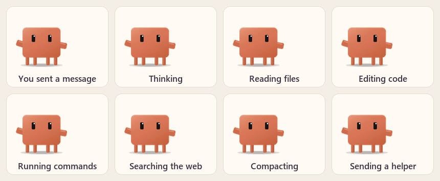

### Keeping an eye on several conversations

Each conversation gets a little circle: blue while it works, orange when it needs you, green when it's done. Hover to see which one; click to jump there.

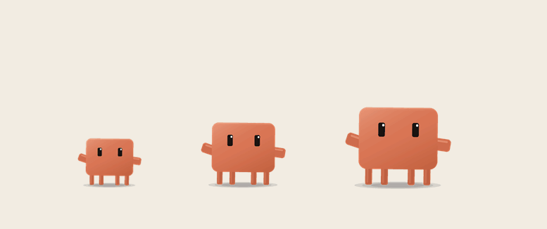

### Digging for treasures

While the AI works, a small one digs. A find is shown off on the spot and carried to the big one when the turn is done. 28 treasures in all; you can also ask them to dig from the right-click menu.

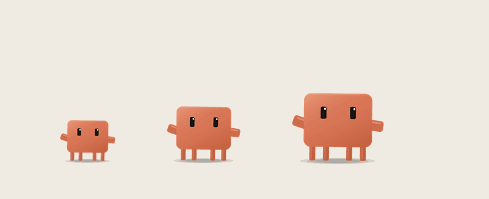

Every treasure can be played with, and each rare or special one has a game of its own.

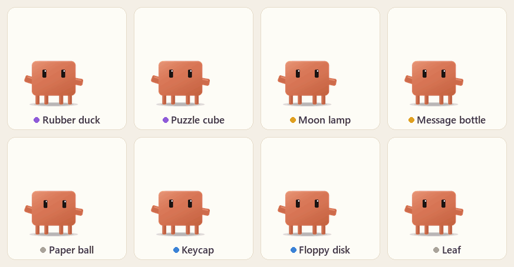

### Playing together

When nothing's going on they high-five, build a tower, play leapfrog, march in a line, pass notes… or pick one from the right-click menu.

<table>
<tr>
<td align="center">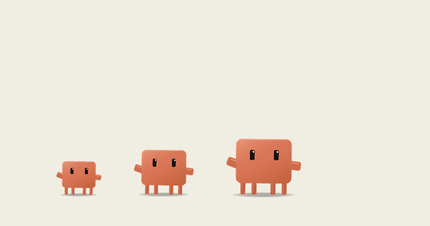<br>High five</td>
<td align="center">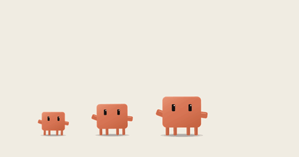<br>Tower</td>
</tr>
<tr>
<td align="center">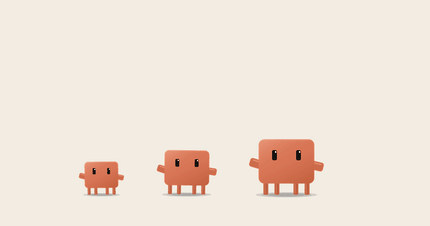<br>Leapfrog</td>
<td align="center">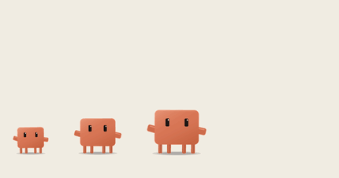<br>Parade</td>
</tr>
</table>

### Levels and the album

The family levels up together, with gifts from level 3 to 20: chalk colours, sign frames, a second batch of treasures and more. Everything they've seen goes into the album; the rest are silhouettes with a riddle.

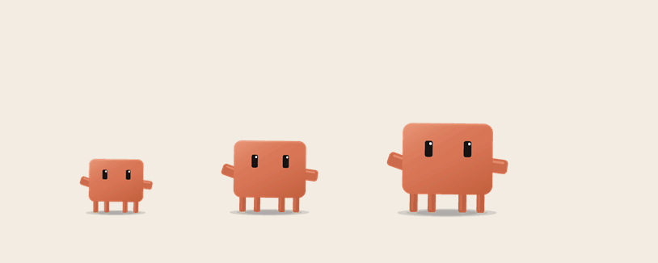

<table>
<tr>
<td>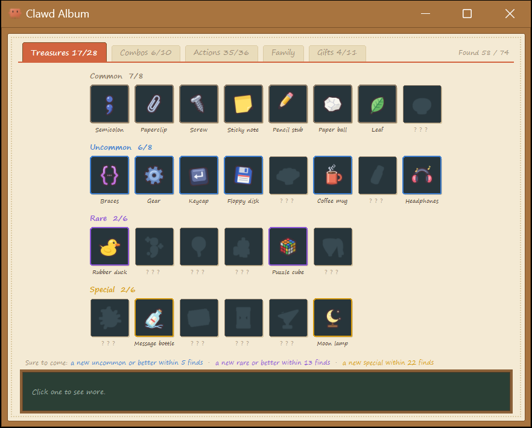</td>
<td>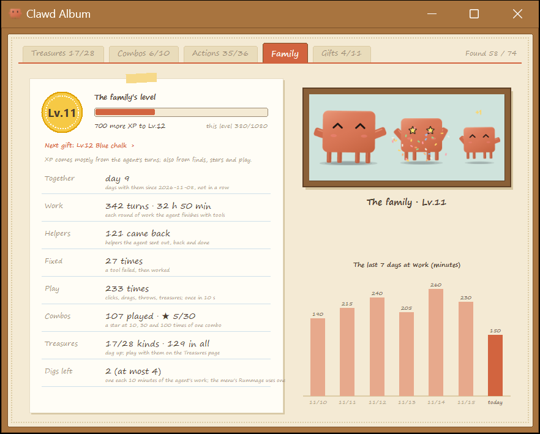</td>
</tr>
<tr>
<td>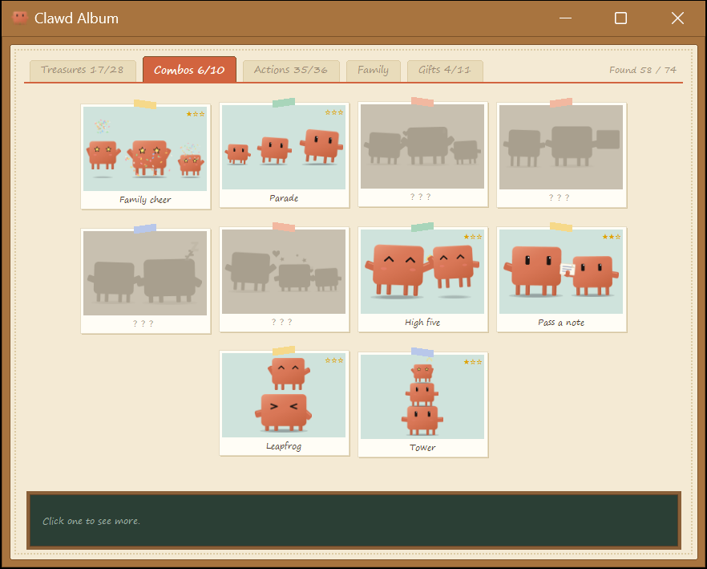</td>
<td>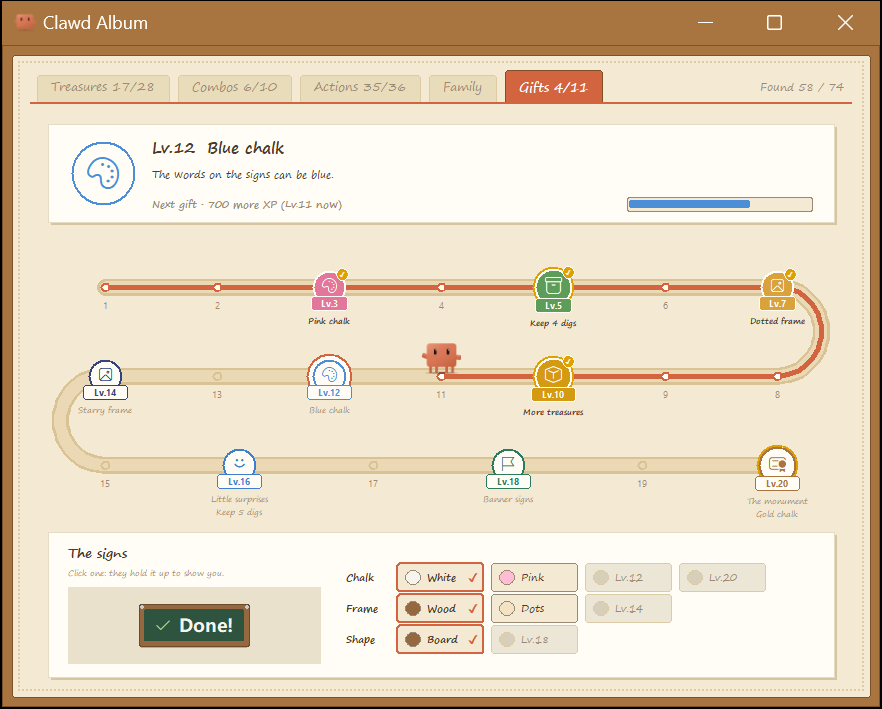</td>
</tr>
</table>

### Connecting your AI takes one tick

On the first start a Connect AI window opens with the AIs you use already ticked: click Apply. Everything else is in the right-click menu.

<table>
<tr>
<td>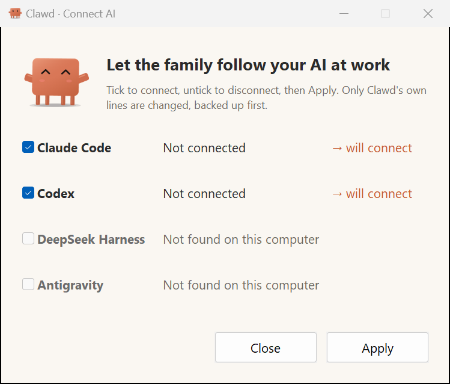</td>
<td>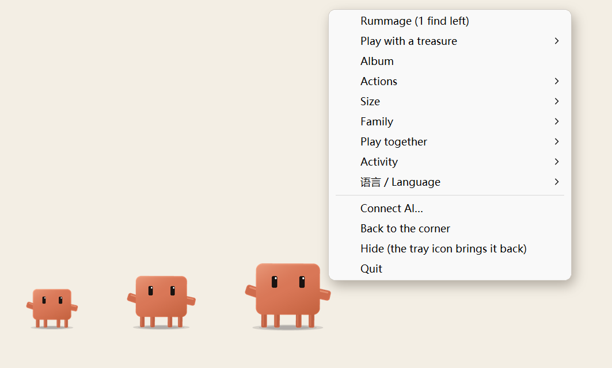</td>
</tr>
</table>

### Light

No model calls, no network, none of your AI quota. Only the kind of thing the AI is doing is noted (reading, running a command…), never the command, a file name or anything you said. Idle: about 0.06% CPU and 50 MB of memory.

---

The full manual follows: installing, every feature, and how the AI is connected.

Just want to play? See [How to Play](GUIDE.en.md). This document describes the current version on the `main` branch.

- [Getting started](#getting-started)
- [All features](#all-features)
- [How the hooks connect](#how-the-hooks-connect)
- [Files and runtime data](#files-and-runtime-data)

## Getting started

### Installing

Download `RedCrab-Setup-<version>.exe` and run it: Python comes with it, nothing else to install, no admin rights needed. You choose where it goes (any drive); the default is `%LOCALAPPDATA%\Programs\RedCrab`. Choosing "install for all users" asks for admin rights and can put it in Program Files. It starts when done; the Start menu has "Red Crab".

- **Updating:** run the new version's installer. It installs into the same folder, has the pets quit first and starts them again afterwards. The save and the connected AIs stay as they are.
- **Moving it:** uninstall, then install to the new place; the save is kept.
- The installer is not signed, so Windows may say "Windows protected your PC": click "More info", then "Run anyway".
- **Mac, Linux:** not supported. You are welcome to port it from the source: the frames, the art, the growth system and the hooks carry over; what needs rewriting is the Windows-only part: the pet windows, the tray icon, finding a conversation's window and jumping to it from a circle.

### Running from source

- Windows.
- Python 3.12 (64-bit, with Tk). The player uses the standard library only; the tests in `tools\` expect Python in `C:\Python312`.
- The frame folders `frames\` and `frames_hi\`. They are not in git: the renderer makes them. It needs `requirements.txt` (numpy, pillow) in `.venv`:

  ```bash
  python -m venv .venv
  .venv/Scripts/python.exe -m pip install -r requirements.txt
  .venv/Scripts/python.exe prerender.py --body-px 100 --out frames --no-preview
  .venv/Scripts/python.exe prerender.py --body-px 300 --out frames_hi --no-preview
  ```

- Start it: `python clawd.py` (the first start opens the Connect AI window).

- The commands below take the code to be in `E:\clawd` and Python in `C:\Python312`: put in your own places. The programs find their paths from where they are, so any folder works; before moving it, run `hooks off` for each agent you connected, and `on` again afterwards.

### Connecting the AI

**The easy way: the Connect AI window.** At the very first start the big one holds up a sign "Right-click me: a menu" and the Connect AI window opens: tick to connect, untick to disconnect, then `Apply`. The first time, the agents that have run on this computer are already ticked; where a tick differs from how things are, it says "will connect" or "will disconnect" beside it. After Apply each says how it went and what is left to do (trust the hooks in Codex's settings, restart DeepSeek), and the window stays for more. Agents that are not there are greyed. Open it again any time from `Connect AI…` in the right-click or the tray menu, or with `clawd connect`. It does what the commands below do: only the lines we add are touched, backed up first.

**Or with a command.** For one, run this once inside Claude Code:

```
! C:/Python312/python.exe E:/clawd/clawd.py hooks on
```

It backs up `~/.claude/settings.json` first, then adds 17 hooks (each writes a word; on your message and when a conversation starts they also note which window it is in). Sessions that are already open pick them up too.

**Other agents:** all four share the one family, each wired in on its own: `clawd hooks on <agent>` puts it in, `off <agent>` takes it out (only what we added, backed up first), and `clawd hooks status` shows all four at once.

| Agent | How | Where it goes | What does not show | A click on its circle |
|---|---|---|---|---|
| Claude Code | `clawd hooks on` | `~/.claude/settings.json`, 17 hooks | —— | The desktop app: that conversation; Windows Terminal: that tab; other terminals: the window |
| Codex | `clawd hooks on codex`, then trust them in Codex (`/hooks` in the CLI, Settings > Hooks in the app) | `~/.codex/hooks.json`, 12 hooks | Reading files, the web, a tool failing, its own background jobs (not your conversations) | The desktop app: that conversation; a terminal: the window |
| DeepSeek Harness | `clawd hooks on deepseek`, then restart DeepSeek | The plugin `clawd_dsh.mjs` (loaded by a few lines at the end of `~/.dsh/profiles/desktop/cordis.patch.yml`) | Compacting | Its window (no link to one conversation) |
| Antigravity | `clawd hooks on antigravity`; new conversations pick it up | A `"clawd"` entry in `~/.gemini/config/hooks.json`, 4 hooks | Your turn, a sub-agent sent, compacting, a conversation's end; a tool shows when it is done | Its window (likewise), brought back from the tray |

**The hooks only listen:** for every agent, our hooks and plugin only write a word to the event file: they allow nothing, deny nothing, add nothing to the conversation, and a failure of ours is not the agent's. Claude Code's and Codex's run in the background (`async`): the agent does not wait for them. DeepSeek's plugin passes on everything it could stop, as it came. Antigravity waits for each hook's answer, so it gets only the four that need no say, each answering `{}`, and `cmd` answers `{}` itself should the program folder or Python be gone. Antigravity's hook before a tool runs is left out: it takes no say as a denial and blocks every tool. Before moving or deleting this folder, `hooks off` each agent wired in.

### Commands

`clawd ...` below is short for `python clawd.py ...`: from source, `C:/Python312/python.exe E:/clawd/clawd.py ...` (a `clawd` function in your PowerShell profile saves typing); an installed copy has it as `python\python.exe clawd.py ...` in its folder.

| Command | What it does |
|---|---|
| `clawd` | Start, with as many pets as last time; if it is running but hidden, show it |
| `clawd 1` / `2` / `3` | Switch the number of pets at once; starts them if they are not running |
| `clawd off` | The whole family quits; size and number are kept; next time they start in the bottom-right corner |
| `clawd hide` / `show` | Hide / show the whole family (like clicking the tray icon) |
| `clawd size 150` | Make the whole family bigger or smaller, in proportion |
| `clawd size` | Show the current size |
| `clawd do <action>` | Play an action or a combo, e.g. `clawd do high five` |
| `clawd do play [treasure]` | Take out a treasure you have and play with it; none named: any one |
| `clawd list` | List all actions and combos |
| `clawd status` | Show whether it is running, whether it is hidden, and the family's level (see "Growth") |
| `clawd circles` | List the conversations' circles: which conversation each is, desktop app or terminal, where a click goes (look here first when a click does not get there) |
| `clawd activity quiet` / `normal` / `lively` | Activity: quiet / normal / lively; with no argument, show the current one |
| `clawd autostart on` / `off` | Start with Windows on / off (like the tray menu's `Start with Windows`); with no argument, show the current state |
| `clawd lang en` / `zh` | Switch the language (English / Chinese); with no argument, show the current one |
| `clawd hooks on` / `off` / `status` `[claude\|codex\|deepseek\|antigravity]` | Install, remove or list the hooks (a plugin for DeepSeek); without an agent it is Claude Code |
| `clawd connect` | Open the Connect AI window (like `Connect AI…` in the right-click and the tray menu) |
| `clawd hooks refresh` | Our hooks pointing elsewhere (the program was moved): make them point at this copy; an installed copy does it at each start |
| `clawd uninstall` | For uninstalling: quit, take out every agent's hooks and this copy's start with Windows; the save stays, and it says where |

The interface comes in Chinese and English. The menu's `语言 / Language` and `clawd lang` both switch it; the menu, the action names and the command-line messages all follow. `clawd do` accepts both the Chinese and the English names (e.g. `clawd do high five`). The choice is kept in `state.json` across restarts. Until you pick one it follows Windows: Chinese on a Chinese Windows, else English.

### Mouse

| You do | It does |
|---|---|
| Click | Waves or hops |
| Double-click | Celebrates |
| 3 clicks within 2 s | Shy |
| Hover | Looks at you (at most once every 10 s) |
| Leave the cursor still near one of them (within 3 body lengths) | Cursor nap: the nearest idle one looks over to the cursor's side at 3 s, walks up to half a body towards it at 5 s (staying within its own area), and sits down and dozes off at 8 s (its head nods, a bubble swells and pops). Move the cursor near it or over it and it wakes with a start and a "!"; not again within 15 s. Moving the cursor far away does not wake it: it dozes on for about 40 s, then stretches and gets up. If the cursor stays still until the family would fall asleep, it drifts into real sleep |
| Drag / let go | Dangles / lands; near a screen edge it glides over to sit flush against it |
| Drag and fling, letting go while still moving | Thrown: it tumbles head over heels, bounces off the sides and the top, falls to the bottom line and bounces twice, sits dizzy with stars going round, then gets up; family members nearby come over and pat it. Click it in the air to catch it; a plain click lets it fall on |
| Drop one pet on another | High five; dropped on the head of a bigger one: a tower |
| Ctrl + mouse wheel | The whole family gets bigger or smaller |
| Right-click | Menu |

**Right-click menu:**

- `Rummage (N finds left)`: the one you clicked digs, see "Rummaging and treasures"
- `Play with a treasure`: take out a treasure you have to play with (greyed out while you have none)
- `Album`: open the album (with how many new things, if any)
- `Actions`: play any action by hand
- `Size`: the whole family's size; sizes below the lower limit are greyed out
- `Family`: one, two or three pets
- `Play together`: High five, Family cheer, Come and look, Nudge awake, Parade, Comfort, Tower, Pass a note, Leapfrog
- `Activity`: Quiet / Normal / Lively (also in the tray menu), see below
- `语言 / Language`: 中文 / English
- `Send this one home`: only on the small ones; closes just that one
- `Back to the corner`: the whole family goes back
- `Hide (the tray icon brings it back)`: the whole family hides
- `Quit`: the whole family quits

Clicks on the transparent parts of the window go through to the program below, and the pets never take the keyboard focus.

**Activity** is how often they find something to do by themselves: idle moves, walks, combos of their own, and the small ones copying, watching and playing while the big one works. `Quiet` makes the waits for idle moves and walks about twice as long, starts no combos of their own, and while the big one works the small ones do not copy, watch or play; `Lively` makes them about 0.6 times as long. Taking a treasure out to play with while idle: about every 6 minutes at normal, every 12 quiet, every 3 lively. Their own shows (games, copying, coming to watch) keep at least 20 s apart (40 s quiet, 12 s lively), so they never bunch up. The work clips, the signs, the reactions to the end of a turn and to errors, and whatever you ask for (clicks, drags, the menu, `clawd do`) are the same at every level. The choice is kept in `state.json`.

### Tray icon

There is a small Clawd icon at the right end of the taskbar (Windows 11 may put it under `^` at first; you can drag it out).

- **Click:** the whole family hides; click again and it shows. The icon is dimmed while they are hidden.
- **Right-click:** `Hide` / `Show`, `Back to the corner`, `Album`, `Activity`, `Connect AI…`, `Start with Windows` (ticked = on), `Check for a new version` (opens the GitHub releases page in your browser; the pet itself never goes online or checks by itself), `Quit`.

**Start with Windows is off by default.** Turned on, it adds one entry `Clawd` to this user's startup list (`HKCU\...\CurrentVersion\Run`); at sign-in the family appears in the bottom-right corner with the last number and size. Untick it and the entry is removed, together with Task Manager's 'disabled' mark. If you disable it in Task Manager's Startup apps, the menu shows it unticked.

While hidden nothing is drawn; it only keeps reading the agents' events, using even less CPU than when shown. When it shows again it is in the current state (the big one at work plays its work clip; if a question is still waiting for you, the sign goes up again). `clawd do` with an action or a combo shows the family first. After a restart it is always shown.

### Closing and removing

- Close: right-click `Quit`, the tray icon's `Quit`, or `clawd off`. To have them out of sight without closing, click the tray icon to hide them.
- Disconnect one agent: untick it in the Connect AI window, or `clawd hooks off` (Claude Code), `clawd hooks off codex` and so on. Only what we added is removed; other hooks are left alone.
- Take it all out: an installed copy is uninstalled as "Red Crab" in Windows Settings → Apps: it quits, removes every agent's hooks and the start with Windows, then asks whether to delete the save too (no by default). From source: `clawd uninstall`; the save stays.

## All features

### A family of three

- **One by default, up to three:** one process runs all the windows.
- **Fixed proportions:** 100 %, 80 %, 60 %; the family is resized together.
- **Size range:** the big one goes up to 300 %. The family stops shrinking when the smallest one reaches 50 %, so the big one's minimum is 50 % with one pet, 63 % with two, 84 % with three. With fewer pets your own size comes back.
- **Roles:** the big one shows the work, the small ones show the feelings.

### While Claude works

**The big one shows what is really going on:**

| What Claude does | Action |
|---|---|
| You send a message | Listening |
| Read, Grep, Glob | Magnifier |
| Edit, Write, NotebookEdit | Typing |
| Bash, PowerShell | Terminal |
| WebSearch, WebFetch | Telescope |
| 6 s after a tool ended | Thinking |
| Compacting the context | Tidy up memory |
| A sub-agent starts / ends | Paper plane / nod (with small ones around, a small one brings it the result as a note, which it reads without stopping work) |
| A tool fails | Startled; failing again within 60 s: confused |
| Waiting for your permission, or a notification | Looks at you and waves in turns, for at most 2 minutes |
| A conversation starts / ends | Waves |
| A turn ends in an error | Shrugs and sweats |

Each work action plays for at least 2.5 s; when they change faster, only the latest is shown. After a tool ends, its action stays for another 6 s before it switches to thinking, so that quick tools (like a search) are seen as well; a new tool or the end of the turn switches at once.

**At the end of a turn:**

| Turn length | Big one | Small ones |
|---|---|---|
| Under 20 s | Hops | One hops |
| 20 s to 2 min | Thumbs up | Both hop in turn; 30 % of the time a high five follows, 15 % a tower |
| Over 2 min | Celebrates | They run to it and celebrate together |

**Other reactions of the small ones:** when you send a message, one looks at you; when a sub-agent starts, one stands on tiptoe to look; when a sub-agent ends, a small one brings the big one a note (at most once in 30 s; otherwise one nods); at a tool's first failure one is startled, and at repeated failures they come over to comfort it; at a question one waves; when a turn ends in an error they come to comfort it too; at the start and the end of a conversation they wave. The same event gets no reaction twice within 3 s, and frequent events like reading files or running commands are not passed on to them.

**Holding up a sign:** the smallest one is the commentator. It holds up a stick with a little wooden-framed blackboard on top that says what Claude is doing, with a small colour icon in front.

| What happens | Sign | For how long |
|---|---|---|
| Starts reading, editing, running a command, searching | Reading / Editing / Running / Searching | about 3 s |
| Sends a sub-agent | Helper sent | about 3 s |
| Thinks a long time without a tool (the big one has been "thinking" for 8 s after your message or after the last tool) | Thinking… | about 4 s, again every 30 s while it still thinks |
| Compacting the context | Tidying memory | as long as it compacts |
| The turn ends | Done! 3 min | about 4 s |
| Waiting for your reply or permission | Your turn | until you reply (at most 2 minutes) |
| The turn ends in an error | Stopped: error | about 4 s |

- **No flickering:** the same kind of tool several times in a row gets one sign; a different tool while it is up just changes the words; after a sign comes down, no sign goes up for a tool for 4 s. The end of a turn, waiting for you and errors can always go up, and replace a tool's sign.
- **Who holds it:** the smallest one with nothing else to do; while it is busy (a combo, being dragged, a cursor nap, copying, something you asked for) the other small one, and if both are busy the sign floats above the big one's head. With only one pet, or when a turn ends in an error (the small ones go to comfort) or after a long turn (they go to celebrate), the sign floats above the big one's head while it works on. A small one you dragged far away holds it up where it is.
- **Smooth:** the stick comes up from the idle pose and goes back to it; the board fades in once the stick is up and fades out before it comes down. The one holding the sign does not wander, does no idle extras and does not copy the big one, and it does not hop at the end of a turn (the other one does). Dragging it, or starting a combo from the menu, takes the sign down first.
- **The words are drawn by the player:** the font size follows the size of the pet that holds it (at least 12 px, so it stays readable); it follows the menu language, and switching the language while the sign is up changes the words at once. Clicks go through the sign's window: it never covers what you click on.

**While the big one works, the small ones are quieter, but not idle:**

- They do not wander, do half as many idle extras, and do not fall asleep.
- **Copying:** when the big one has been reading, typing, running a command or searching for 4 s, a small one now and then copies it for about 3.5 s, at most once every 20–45 s, and does not follow each change.
- **Coming to watch:** when the big one has been running a command or searching for 15 s (other work: 45 s), a small one walks over and watches on tiptoe until the work is done. At most one at a time; another may come after 45–90 s.
- **The two small ones play by themselves:** with three pets, once the big one has worked for 30 s, the two small ones play a game every 2–4 minutes: leapfrog (45 %), a high five (35 %) or passing a note (20 %), without the big one and near where they are. Afterwards they walk back. No game starts while one of them is watching or holding up a sign.

### While idle

| Action | How often |
|---|---|
| Breathing | always |
| Idle extras: wink, look at you, tiptoe peek, hop, hands on hips | each pet every 6–15 s |
| A walk, only within about 1.2 body lengths either way of its own place; turns at a screen edge or another pet | each pet every 30–70 s, half of the time |
| High five (22 %), parade (17 %), leapfrog (15 %), tower (13 %), pass a note (13 %), comfort (12 %) or family cheer (8 %) | every 2–4 minutes while all are idle |
| The whole family sleeps | after 5 minutes without interaction |
| Nudge awake | 4–12 minutes after the whole family fell asleep, half of the time |

Waking from sleep always starts with a "wake up" of about 1 s. Exceptions: clicking the sleeping one directly, or resizing; then it is startled.

The cursor nap counts from the moment it looks over until it wakes, and other things leave it alone meanwhile: the sign, the hop at the end of a turn, comfort, a note, copying, watching and their own games go to another pet, or do not happen (the sign floats above the big one's head). Only these wake it, with a start first: the big one starts working (when the dozing one is the big one), a click or a combo you choose, the whole family's cheer after a long turn, a level-up (one far from the big one sleeps on). Picked up or thrown, it simply wakes. `Doze` under `Actions` in the right-click menu, or `clawd do doze`, makes it nap too: it gets up by itself after about 8 s, and moving the cursor does not wake it.

### Combos

| Combo | What happens | Starts by itself |
|---|---|---|
| High five | A small one walks to the big one, jumps up and slaps its hand, stars burst (while the big one works, the two small ones do it) | idle; sometimes after a middling turn; the two small ones' games |
| Family cheer | The small ones walk to either side of the big one and celebrate in turn | idle; after a long turn |
| Come and look | A small one walks next to the big one and watches on tiptoe | the big one has been running a command or searching for 15 s, other work 45 s |
| Nudge awake | Another one walks over and nudges twice; the sleeper gets up and nods | some time after the whole family fell asleep |
| Parade | The small ones line up behind the big one, they walk a bit, turn together and walk back, now led by the smallest | idle |
| Comfort | The small ones walk to either side of the big one and pat it three times, little hearts float up, the big one nods. The big one need not stop working | repeated tool failures; a turn that ends in an error; idle |
| Tower | The big one stands firm as the base, the small ones jump up one by one (with three, the smallest on top), the top one cheers, then they jump down from the top | idle; sometimes after a middling turn; dropping a small one on the big one's head |
| Pass a note | A small one takes out a note, carries it over and hands it to the big one (when idle, sometimes to the other small one); the other takes it, reads it and puts it away | a sub-agent ends (the big one need not stop working); idle; the two small ones' games |
| Leapfrog | The bigger one ducks and curls up, the smaller one jumps over its head; then the other way round, so both move on two steps. With three pets the two small ones play it, with two pets the big one and the small one (the big one walks straight back afterwards). They jump the way that keeps them nearer to where you put them | idle; the two small ones' games |

**Walking over:** at the start of a combo, one trots over to the other in at most about 1.3 s (nudging awake: 2.6 s); walking back after a combo or out of another one's way is brisk too, at most 4.5 s. The legs keep pace with the speed. The parade keeps its own speed.

**Far away: no coming over by themselves.** In the combos they start themselves (idle, end of a turn, comforting after errors, bringing a note, coming to watch, nudging awake, the two small ones' games), a pet more than about 4 of the big one's body lengths from it is left out; the ones near still play, and nobody walks farther than that, so no one crosses the screen. Combos you start from the menu, with `clawd do` or by dropping one on another have no such limit.

**Priorities, highest first:** your hand > work and questions > combos > idle extras and walks.

**Called away while it digs:** if you drag it, choose another action for it, or (the big one) a new work event comes, it stands up first and the hole closes, then it does the other thing; a dig that brought nothing up does not count and uses no find.

**What ends a combo early:** only a new order from you: dragging one that takes part (or the big one), choosing an action from the menu for one that takes part, choosing another combo, changing the size or the number of pets, hiding them; and the big one leaves when Claude starts working or asks a question. Hovering, or opening the right-click menu (on any of them), does not. The tower is the exception: a poke and it comes down.

**What counts as once:** a combo played to its end (first finds, counts and stars, the XP for one set up by hand all go by this); one that was ended early does not.

**Afterwards:** the small ones walk back to where they stood 3–7 s later (also while the big one works; only one that came to watch stays until the work is done). One you dragged does not walk back; ones you dropped on another for a high five or a tower stay where they are.

**What interrupts a combo:** dragging one that takes part, dragging the big one, resizing, changing the number of pets. A work event while the big one takes part also cancels it, and the big one goes to work at once. A one-shot action under way is never cut, except in a tower and in leapfrog: when cancelled, the ones up there jump down at once (on a resize or a change in the number of pets they are put straight back on the floor; one in the middle of a leap lands right where it was going), and clicking any pet of a tower brings it down.

### Growth

The whole family shares one level and one pool of XP: Claude's work gives a lot, playing with them a little. There is no daily cap.

| What gives XP | XP |
|---|---|
| A turn ends (tools were used, it did not stop on an error; a message in the middle keeps it one turn) | 5, plus 2 for each minute of the turn's work time (no cap) |
| A tool failed in the turn and a later one worked (once a turn) | 5 |
| A sub-agent comes back done | 3 |
| A combo played to its end for the first time | 20 |
| One of the 9 special actions seen for the first time | 10 |
| The same combo played 10, 30, 100 times (one, two, three stars) | 10, 15, 30 |
| A combo you set up by hand (dropped on another for a high five, put on a head for a tower, patted after a throw) | 3, once a minute at most |
| A treasure found for the first time | 20 (more of the same are only counted) |
| Clicking, dragging, throwing, waking one that dozes | 1–2, once in 10 s at most |

A turn that used no tool counts for nothing. Each level takes more XP than the last: Lv.1→2 takes 40, Lv.2→3 113, Lv.3→4 208.

- **Level up:** once the turn's own reaction is over and the big one is calm, the family cheers (a lone pet cheers by itself) and a gold board goes up, "Level up! Lv.N", with a bar showing how much is left to the next level, for about 6 s. The top level is 20, about half a month of ordinary use away: the first levels come quickly, from Lv.10 on it is about a level a day.
- **Level gifts:** levels 3, 5, 7, 10, 12, 14, 16, 18 and 20 each bring a gift, held up on a pink board after the level's ("Gift: ..."): chalk colours for the signs' words (pink, blue, gold), sign frames (dots, stars), banner signs, more digs kept (4, then 5), a second batch of treasures, little surprises (from Lv.16 a high five now and then misses, a leapfrog goes over head over heels, the top of the tower comes down with a flip; each is a find the first time), and the level-20 gift (in the fold below). Levels reached before an update get their gifts at the first start, one board each ("Late gift: ..."). The next gift is on the album's Gifts page, the Family page, the tray tip and `clawd status`.
- **New find:** when a combo is played to its end for the first time, a mint board goes up, "New: <combo>!", for about 5 s. It counts however it began: by themselves, set up by your hand, or from the menu.
- **Special actions:** Shy, Dangle, Thrown, Dizzy, Doze, With a start, Stretch, Shrug and Startled: the first time one of these 9 is seen, a "New" board goes up too. The other, common actions are only written down, with no board.
- **Stars:** every combo is counted, whoever began it. At 10, 30 and 100 times it gets a star and a board, "High five ★ Well practised!".
- **A combo is a combo, whoever plays it:** the album's combos are the ones you can start yourself, the 9 in the right-click menu's "Play together" and the pat after a throw. Whoever takes part or begins it, it counts the same; click it a few more times for the stars.
- **Rummaging and treasures:**
  - **Work time:** digging and XP go by the time the AI really works, not by the number of turns: from your message on, but not while it waits for your approval or answer (an orange circle), not past 5 minutes without a word (unless a command of it still runs), and not a helper's work after the turn's end. A turn that only talks and uses no tool counts for nothing. With several conversations at work at once, each counts for itself for the digs by themselves and for XP (each with its own cap on digs), while the digs by hand count the time once: 10 minutes of two conversations at once still earn one.
  - **By itself:** once a turn has used a tool, each 2 minutes of its work a small one that is free crouches and digs a hole in front of it (earth lands on its face; afterwards it stands up and shakes itself), and four digs in ten bring something up; a turn has at most as many of these digs as the chances you can keep (3, 4 from Lv.5, 5 from Lv.16). A find is held up for a moment and put away; with nothing, it droops for a while. When the turn ends and the "Done!" board is down, the find is shown, and a board says "Found: Rubber duck (rare)": a common one is held up where the finder stands; one that is uncommon or better is carried to the big one and handed over, the big one holds it high, and the other small one comes to look from the other side; for a rare or special one all of them cheer afterwards. Several finds in a turn are handed over one after another. The treasure is yours from the moment it sets off: if you pick it up on the way, or a new turn begins, only the showing is lost and the board goes up all the same (one not handed over yet is held up where it stands, if it has a calm moment). A find that is put away is written to the save at once: quit in the middle of a turn and you get it at the next start. Digs no small one could get to (a lone pet, or the small ones dozing) the big one makes up for when the turn ends, pulling things out from behind its back, with the same odds.
  - **When you ask:** "Rummage" in the right-click menu, or `clawd do rummage` (the big one). Any of the three digs, and the result comes at once. Treasures come from work: each 10 minutes of work time earns one find at once, in the middle of a turn too, and what is over is kept for the next; three are kept at most (four from Lv.5, five from Lv.16), and while they are all there the time does not add up; the menu says how many are left; a new family starts with two. With a find left, six digs in ten bring one up; a dig that gets to its end uses one, find or no find, but after an empty one the next you ask for is sure (one cut short uses nothing); with none left it digs all the same and comes up empty. A click on one that digs lends it a hand: it starts, throws up its arms, and digs faster with more earth flying; what was left of the digging takes half as long, and a find is likelier, and a better one.
  - **One find a turn from their own digging; what you dig up yourself is apart from that** and only asks whether a find is left.
  - **Rarity (the same by hand and by itself):** each find is common 62 %, uncommon 25 %, rare 9 %, special (gold) 4 %. Sure ones: after 8 finds in a row with nothing new of at least uncommon, the next is a new one of at least uncommon; the same after 20 for rare and 40 for special. A find you had already does not reset them, so no luck is lost; once everything of a rarity and above is found, that sure one is gone. The album's treasures page shows only the sure ones (how many more finds until a new one), not the odds. Otherwise one you do not have yet is twice as likely as one you have. The glow behind a find held up has the rarity's colour: pale white for common, blue for uncommon, purple for rare, gold for special.
  - **Special treasures also go with the work:** when it digs by itself (or the big one pulls one out), a turn that fixed an error, searched the web, tidied memory, went over 20 minutes or sent out a helper (and, from Lv.10, one late at night) makes the matching special treasure likelier.
  - The first 20: 8 common, 5 uncommon, 2 rare, 5 special; the gift of Lv.10 adds a second batch of 8 (locked silhouettes in the album before that). Each moves in a way of its own.
  - **Playing with them:** a treasure you have can be taken out to play with. Pick one under "Play with a treasure" in the right-click menu (or "Any one"): the one you clicked plays; or click a treasure in the album and then "Play with it"; or `clawd do play leaf` (no treasure named: any one). It pulls it out from behind its back, plays with it for 4 to 5.5 s and puts it away. The common and uncommon ones each have one of four ways: a close look (it sees something, nods, a little heart), a toss and catch (the second one higher), a shake by its ear to listen, held high like a cup and swayed. The rare and special ones each have a way of their own (in the fold below). Now and then, when they have nothing to do, one of them takes one out by itself (one at a time). The first time a treasure is found, once it has been shown and its board is down, the one holding it takes it out and plays with it there and then. What you ask for happens at once, also while the big one works (it goes back to work afterwards); picked up while it plays, the treasure is put away at once.

<details>
<summary>Every treasure, the rare and special games, the level-20 gift (spoilers)</summary>

- **Special treasures also go with the work:** when it digs by itself (or the big one pulls one out), in a turn that fixed an error, searched the web, tidied memory, went over 20 minutes or sent out a helper, a find is the matching Caught bug, Message bottle, Hardtack, Hourglass or Paper plane model two times in five (the plane this way once a day); one in five if you have it already. Otherwise it is drawn with the odds above.
- The first 20: Semicolon, Paperclip, Screw, Sticky note, Pencil stub, Paper ball, Leaf, Pebble (common); Braces, Gear, Keycap, Floppy disk, Shell (uncommon); Rubber duck, Golden semicolon (rare); and the five special ones. Each moves in a way of its own.
- **The second batch of 8 (the gift of Lv.10; locked silhouettes in the album before that):** Coffee mug, USB stick, Headphones (uncommon); Balloon, Wind-up robot, Puzzle cube, Spinning top (rare); Moon lamp (special: their own digs meet it more often in a turn late at night, 11 pm to 5 am).
- **The rare and special games:** The rubber duck is put down and squeaked, the golden semicolon turned in the light and held high like a cup, the hardtack tossed at its mouth (too hard to bite; knocked on its own head, it goes dizzy), the message bottle uncorked, its message shaken out, read and put back, the hourglass laid on its side stops time (a hop, and it hangs in the air), the bug let go for a loop and back on the hand, and the paper plane model blown on: a loop the loop and back on its stand; in the second batch, the balloon floats up on its long string and lifts the pet off the floor for a while, the wind-up robot marches and the pet marches along until both run down, the cube is cast a spell on: it floats up and turns itself solved, the spinning top is flung down at its feet and whipped whenever it slows (three lashes, and it glows), and the moon of the moon lamp floats up overhead with a piece of night sky behind.
- **The level-20 gift:** the monument. The family cheers once more, and on the album's Family page they stand on a stone pedestal, a brass plate under it keeping the day they set out, the day they got there, the days, turns and treasures, as they were that day.

</details>

- **The album:** "Album" in the right-click or tray menu, or `clawd album`. A scrapbook with five pages: treasures, combos, actions, family, gifts (keys 1–5, Esc closes it). What is not seen yet is a dark outline; click it for a riddle, and ask for one more hint if you like; once found, the riddle stays with its answer after it. The action you pick plays in its snapshot, and a combo's snapshot has all of them in it. A treasure can be taken out to play with, and a combo or an action played ("Play it"). What came since you last looked is sealed (an outline with a red dot, a dot on its tab too) until you click it. The family page shows the level, what is left to the next one, where XP comes from, what each number means, the minutes worked together on each of the last 7 days, and the next gift. The Gifts page is the road from Lv.1 to Lv.20: a badge for each gift (click it to see what it is and how much XP is left), a little Clawd standing where you are; a gift you have not looked at yet has a red dot (so has the tab, and the menu's "Album (N new)" counts it), the page opens on it, and its card says where it shows (the second batch on the Treasures page, the little surprises as ✧ on the Combos page, the level-20 gift on the Family page, the looks of the signs down below); under it, "The signs" picks the chalk, the frame and the shape, and the pets on the desktop hold up the new look to show you. The window can be resized and maximized; everything scales with it. The album is a process of its own and costs nothing once closed; it only reads `grow.json` (the pets save it once a minute, so the newest may be a minute late) and writes only `album.json` (what you have looked at).
- Growth boards give way to work boards: when a work board goes up, they step aside. No level-up while hidden; the cheer comes when the family is shown again.
- The tray icon's tip shows `Lv.N`; `clawd status` shows the level, a bar, and the turns, time worked together, helpers back, errors fixed, days together, combos seen, stars, special actions, the treasures and how many finds are left to dig up by hand.
- It is kept in `grow.json`: written at most once a minute while running, at once on a new level and on quitting. Before the first write of a day the file is copied to `grow.json.bak`, which is used if `grow.json` breaks. With two players on the same home at once (a trial run, say), only the first one writes. The log has one line per turn with its length and tool count, to tune the pace.

### Front, back and collisions

- **Front and back:** the lower its feet on the screen, the nearer a pet looks and the more in front it is drawn. Drag one behind another and it stays there, partly hidden. The one being dragged is always in front.
- **Nothing blocks a drag:** other pets never stop the one you drag.
- **Collisions:** only two with their feet at about the same height (on one row) that overlap count as colliding; after about 2 s the smaller one walks aside, and stays if there is no room. Walks also avoid only those on the same row.
- **High five:** dropping one on another starts a high five only if their feet are at about the same height; otherwise it counts as putting it behind the other.
- **Tower:** drop a small one on the head of a bigger one (feet near the top of its head) for a tower; afterwards it jumps down beside it. The one on top is drawn in front of the one below. In leapfrog the one in the air is drawn in front too.

### Where they live, screen edges and memory

- **Every start in the bottom-right corner:** the big one 24 px from the right and the bottom edge, the small ones in a row to its left. Ones added later line up beside them.
- **They stay where you put them:** each walk of its own stays near the place you put it (at the start: the corner), about 1.2 body lengths either way. Drag it elsewhere and it lives there; carried away by a combo or a collision, it slowly walks back.
- The body never leaves the work area, not even while dragged.
- Let go 16–48 px from an edge and it glides over to sit flush against it; it stays there after a resize.
- At a screen edge a walk turns round. Effects that reach beyond the body may be cut off at an edge.
- Size, number of pets and language are kept in `state.json` and restored at the next start. Positions are kept too but not used at the start (only tests use `--keep-place` to start where they were saved).

### Resource use

Measured (24 logical cores, share of the whole machine's CPU, 2026-11-15): three pets with conversation circles, about **0.06 %**, private memory about **49 MB** (Task Manager's "Memory" is the working set, about 61 MB). Bigger sizes cost a little more.

These figures do not include the hooks themselves. One hook takes about 55–100 ms. The GPU was not measured separately.

**No agent usage:** the pet calls no model and uses no network, and the hooks are local commands that add nothing to the conversation.

## How the hooks connect

### Overview

There is no direct connection between Claude Code and the pet, and no network. They are linked only by **one configuration and one file**.

```
CLI session ─────┐                                                    ┌→ appends "run 7b3befbc"
                 ├→ both read ~/.claude/settings.json, run hooks ─────┤
Desktop session ─┘                                                    └→ appends "read 1a411b99"
                                                                                ↓
                                                                      %APPDATA%\Clawd\event
                                                                                ↓
                                                  the pet checks it about every 150 ms; only the big one reads it
```

- **Claude Code runs them:** the hooks are run by Claude Code. Starting the pet asks Claude for nothing, and the pet needs no permission or account details.
- **Independent:** without the pet running, the hooks still write the file and report no errors; with the hooks off, the pet just idles.
- **Many conversations, one family:** every Claude Code conversation on this machine that reads this configuration writes to the same file. Cloud sessions run on other machines and by design cannot write to it (not tested).

### The 17 hooks (Claude Code)

All of type `command` in exec form (Python run straight, no shell; see "What a hook looks like" below), with `async: true`: Claude does not wait for them.

| Claude Code event | matcher | Word written | Meaning for the pet |
|---|---|---|---|
| `UserPromptSubmit` | all | `listen` | You sent a message; busy from now on |
| `PreToolUse` | `Read\|Grep\|Glob` | `read` | Magnifier |
| `PreToolUse` | `Edit\|Write\|NotebookEdit` | `edit` | Typing |
| `PreToolUse` | `Bash\|PowerShell` | `run` | Terminal |
| `PreToolUse` | `WebSearch\|WebFetch` | `web` | Telescope |
| `PostToolUse` | all | `think` | The tool ended: thinking |
| `PostToolUseFailure` | all | `fail` | A tool failed |
| `SubagentStart` | all | `agent` | A sub-agent starts |
| `SubagentStop` | all | `agent_done` | A sub-agent ends |
| `PreCompact` | all | `compact` | Compacting the context starts |
| `PostCompact` | all | `compact_end` | Compacting ends; back to what it did before |
| `Stop` | all | `stop` | The turn ends; reaction by its length |
| `StopFailure` | all | `stopfail` | The turn ends in an error |
| `PermissionRequest` | all | `attention` | Waiting for your permission |
| `Notification` | all | `attention` | A notification |
| `SessionStart` | all | `hello` | A conversation starts |
| `SessionEnd` | all | `bye` | A conversation ends |

Other tools have no `PreToolUse` hook: the pet keeps its current action, and those tools only bring a `think` when they end.

`SessionStart` and `UserPromptSubmit` also carry `--at` and write a line `at <session> <window handle> claude`: the window this conversation is in. It is the nearest ancestor of the hook's process that has a visible window (the terminal, the editor, the Claude desktop app); about 90 ms, once a message. Only the handle is kept: no window title is read and no other window is looked at.

### The conversations' circles

Once a conversation has been at work, small numbered circles appear at the big one's feet, one a conversation: blue at work, orange waiting for you (asked for a permission or an answer mid-turn: orange however long you take, till its next step), green done, red stopped on an error, grey interrupted by you (after the pets restart, or with no signal for a long time, a conversation not ended stays blue: it may still be thinking; it goes after 30 silent minutes). Click a circle and that conversation's window comes to the front (restored if minimised). With two or more, the signs start with the number too (`② Done!`); with one they do not. A minute after its turn is done (green), stopped on an error (red) or interrupted by you (grey) the circle goes by itself, and comes back with the next message, taking the smallest number free (the numbers only tell the order); it also goes when its conversation ends (`bye`), its window is closed, or it has been idle and silent for 30 minutes; when its window just goes (killed, crashed, or an agent like Antigravity that sends no end), that conversation's work ends with it, so the big one does not work on for nothing. Rest the mouse on a circle and a board over it says "① <conversation name> · working / done / your turn" (with circles of several agents, whose it is first: "② DeepSeek · <name> · done"): the name the agent shows, following a rename at once (read from where the Claude desktop app, Claude Code in a terminal and Codex keep the names; only the name, only while the mouse is there; a new Codex conversation not named yet shows its first message). Codex's own background jobs (its memory work, say) run its hooks too, but they are not your conversations and get no circle; a Codex sub-agent counts on the conversation that sent it (both told by Codex's own thread list, `state_5.sqlite`, read only). How exact the jump is: conversations in the Claude desktop app or in Codex are opened themselves (with their own `claude://` and `codex://` links); in Windows Terminal the very tab comes up: the tab you sent a message from is remembered (by the id Windows gives the tab, so renaming it does not matter) and selected again on a click (`clawd_tabs.ps1`, about half a second); several terminals in VS Code share a window, so only that window comes up; DeepSeek and Antigravity keep all their conversations in one window with no link to one of them, so their window comes up, called back from the tray if it is there (while the app runs on in its tray, its circles stay). No circles while the family is hidden or the big one is dragged or thrown.

**Where a click goes is told, not guessed:** whether a Claude conversation is in the desktop app or a terminal, its hook tells the pets (the `CLAUDE_CODE_ENTRYPOINT` Claude Code gives its hooks), or else the `entrypoint` its transcript records; a desktop conversation resumed in a terminal with `/resume` (or the other way) moves its circle along. One rule for each kind: the desktop app opens its link, Windows Terminal selects its tab, any other terminal (Git Bash's own window too) brings its window. Close the pets and start them again and the circles come back with their numbers and colours (`talks.json`), and a click still gets there; one whose window was closed meanwhile does not come back, and an orange one back this way goes after 30 silent minutes (what that conversation did while the pets were closed, they cannot tell). The PowerShell that reads the tabs is found where it is installed, not by PATH (pets started from the Claude desktop app had a pwsh first on PATH that cannot run at all), and Windows PowerShell, always there, when there is no PowerShell 7. Claude Code's Code Mode runs the "you sent a message" hook when it hands a script's output back to Claude too; the hook knows it (`source` `poll_event`) and writes nothing, so it is not taken for a new turn.

### Esc

Claude Code sends no hook when you interrupt a turn (Esc, the stop button; its docs: `Stop` does not run on a user interrupt), so on its own the big one would work on until your next message or the 10-minute safety net. So when a Claude Code conversation at work has said nothing for 15 seconds, the pets look at its transcript every 5 seconds (the `.jsonl` under `~/.claude/projects/`: only its last 16 KB, only whether its last message is the "`[Request interrupted by user]`" line Claude Code writes). If it is, the turn counts as interrupted: the big one stops quietly (no "done" sign), the circle turns grey and says "interrupted", and goes a minute later. Long thinking, a long command or a permission waiting for you does not end with that line, so it works on. Codex's stop button sends no hook either, and is seen the same way: if the last turn mark in its rollout (the thread's `rollout_path` in Codex's thread list, only the last 256 KB) is `turn_aborted`, the turn was interrupted; stopped and sent again at once (a new `task_started` last), it works on. Antigravity and DeepSeek write `cut` themselves when you stop them.

### Other agents: a table of words each

The pets only know the words in the event file, not who wrote them. `AGENTS` in `clawd.py` holds a table per agent: which of its events and tools is which word. Codex: `UserPromptSubmit`→`listen`, `PreToolUse` of `Bash`→`run` and of `apply_patch`→`edit`, `PostToolUse`→`think`, `SubagentStart`/`SubagentStop`→`agent`/`agent_done`, `PreCompact`/`PostCompact`→`compact`/`compact_end`, `Stop`→`stop`, `PermissionRequest`→`attention`, `SessionStart`/`SessionEnd`→`hello`/`bye`. On Windows Codex's hooks need not run in bash, so `clawd_hook.py` writes every word (it reads only the session id at the start of the input); Codex has no "tool failed" event and reads files through its shell, so there is no `fail`, `read` or `web`.

DeepSeek Harness's table lives in the plugin `clawd_dsh.mjs`, on its own events (0.2.1): a step with a new message (`agent/pre-step`)→`listen`, a tool starting (`tools/pre-execute`): `pwsh`→`run`, `read`/`glob`/`grep`→`read`, `edit`/`write`/`str_replace_editor`→`edit`, `web_fetch`/`web_search`→`web`; a tool done→`think` (failed→`fail`), the turn ending (`agent/turn-stopping`)→`stop`, an error (`agent/error`)→`stopfail`, a sub-agent sent and back→`agent`/`agent_done`, a question for you (`user-questions/request`) or a request for your approval (`approval/request`)→`attention`. Stopping it yourself sends no event of its own: going idle (`agent/status`) with the turn not reported ended writes `cut` (the pets take it as interrupted by you: they stop, no done sign, the circle grey). A sub-agent's tools count for the conversation that sent it. Each message also writes `at <session> 0 deepseek`: DeepSeek is a one-window app, and the pets find that window by its program. Names come from `title` in `~/.dsh/storages/session_projcache/sessions/session-<id>.json`. DeepSeek (0.2.1) has no link to one conversation, so a click on a circle brings its window, brought back from the tray by showing it (DeepSeek only hides it; `dsh://open` would start a second copy of the app to pass that on, about 2 s); `dsh://open` only when DeepSeek is not running. When DeepSeek quits, the plugin writes `bye` for each conversation that worked, so the pets stop and the circles go at once. Its session ids are `session-` plus a UUID; the 8 characters after the prefix are used. Should a later version rename one of these events, that one thing stops showing; DeepSeek itself is not affected.

Antigravity's table is `AG_TOOLS` in `clawd_hook.py` (2.31): one hook per event, matcher `*`, translated by the tool's name. A conversation starting (`SessionStart`)→`hello`; it has no "you wrote" event, so the first model call after a `stop` (`PreInvocation`) is a new turn→`listen` (`ag_turns.json` keeps which conversations are mid-turn; one silent for 10 minutes counts as over); a tool done (`PostToolUse`) writes the tool's word first: `view_file`, `list_directory`, `grep_search`, `find` and the like→`read`, `code_action`, `write_to_file`, `replace_file_content`…→`edit`, `run_command`, `send_command_input`…→`run`, `search_web`, `read_url_content`, `browser_*`…→`web`, a sub-agent→`agent_done`, then `think` (with `error`→`fail`); `Stop` with reason `ERROR` or `MAX_TOKEN_BUDGET_EXCEEDED`→`stopfail`, stopped by you (`USER_CANCELED`)→`cut` (the pets take it as interrupted by you: the big one stops without the done sign, the circle turns grey), anything else→`stop`. A sub-agent it sends is a conversation of its own with hooks of its own; the pets read its own record (`conversations/<ID>.db` names the conversation that sent it) and count it on that one's circle, with no circle of its own; Antigravity ends a turn as it sends one out, so while the sub-agent works that conversation is at work again (its circle blue, back if it had gone), and green when the sub-agent is done. Every hook answers `{}`. No `PreToolUse`: it takes an answer without a `decision` as a denial ("tool call denied by pre-tool hook"), and answering `allow` would get around your own permission settings. So a sub-agent sent and a question for you do not show; a sub-agent back does. The first one of a turn also writes the `at` line: Antigravity's background process starts the hooks, and its main window is just above it. Names come from `title` in `~/.gemini/antigravity/conversation_summaries.db` (read only). It (2.31) has no link to one conversation, so a click on a circle brings its window, and `antigravity://open` brings it back from the tray. It has no permission-request, compaction or session-end events, so those do not show.

### What a hook looks like

One entry in `~/.claude/settings.json`:

```json
{
  "matcher": "Read|Grep|Glob",
  "hooks": [
    {
      "type": "command",
      "command": "C:/Python312/python.exe",
      "args": ["-I", "-S", "E:/clawd/clawd_hook.py", "read", "claude", "#clawd-event"],
      "async": true
    }
  ]
}
```

With `args` it is the **exec form**: Claude Code starts the program `command` names with `args` as its arguments, as written, and no shell in between.

| Part | What it does |
|---|---|
| `-I -S` | Python's isolated mode: no environment variables or modules from the current folder, no site; quick to start (about 30 ms) |
| `clawd_hook.py read claude` | Reads the session ID from the start of the JSON on stdin and appends "`read` + 8 characters of the session ID" to the event file. It reads the first 4 KB only and is gone, never waiting for stdin to close |
| `--at` (`UserPromptSubmit`, `SessionStart` only) | Also writes an `at` line: the window this conversation is in |
| `#clawd-event` | A marker: `hooks on/off/status` recognise their own hooks by it and leave others alone; `clawd_hook.py` ignores arguments starting with `#` |

**Why no shell:** bash one-liners are not dependable. On Windows, when Claude Code finds no Git Bash it runs hooks in PowerShell (it works out where bash is from the first `where git` result, and cannot when Git lives elsewhere and `ucrt64\bin\git.exe` comes first on `PATH`), where the bash lines wrote nothing at all; bash's `read -n 300` also waited on for input of under 300 characters (a conversation starting or ending) while stdin stayed open. The exec form is the same with or without Git Bash, with or without spaces in the paths. It needs a Claude Code that knows a hook's `args` (2.1.325 works).

**Safety:** only 8 hex characters of the session ID are kept; the word must be lower-case letters and underscores; with no shell, nothing in your messages can ever run as a command. On any error it quits quietly with 0 and never bothers Claude.

### The event file

The event file `event` (in the data folder, usually `%APPDATA%\Clawd`) is plain text, one event per line:

```
listen 7b3befbc
read 7b3befbc
think 7b3befbc
run 1a411b99
stop 7b3befbc
```

- The first word is the action word, the second 8 characters of the session ID: the first 8, or for Codex the last 8 (its IDs start with the time, to about a minute, so a conversation, Codex's own background jobs and its sub-agents started in the same minute would share the first 8).
- No ID, or an invalid one (it must be 8 characters of hex digits and `-`), counts as the "no ID" session. `clawd do` and `clawd size` write such lines.
- Other words it accepts: action names, `quit`, `size:<percent>`, `family:<number>`, `combo:<combo name>`, `lang:<zh|en>`, `cut` (stopped by you), `at` (which window a conversation is in, see above).

### How the pet reads events

`EventChannel` in `clawd_pet.pyw` does it:

1. About every 150 ms it checks with `os.stat` whether the file changed. If not, it does not even open it; this costs next to no CPU.
2. It remembers how far it read and reads only what is new.
3. A file over 16 KB that has been read to the end and unchanged for 2 s is emptied, so it never keeps growing.
4. It notices when the file was emptied or rewritten and reads it from the start. Half a line waits at most 0.3 s.
5. At the start it skips old content; only a last line written within 3 s is replayed.

### How several conversations get along

The pet keeps state per session ID, and the one big pet shows it:

- **Busy:** each session has its own start time and current action. As long as one is working, the big one works, showing the action of the latest event.
- **End:** when one session sends `stop`, its reaction plays first, then the big one goes back to the other session's action.
- **Background sub-agents:** tool events of a session after its `stop` come from background sub-agents, which send no `stop`, so they keep it busy for 20 s only.
- **Safety net:** without an end signal it stops being busy after 10 minutes; while a command it began has not ended it stays busy, up to an hour.
- **Questions:** only the session that asked can clear the question state; another session's work does not.

### How the small ones hear of events

The small ones do not read the file and are not connected to the hooks. After the big one has handled an event, `Family` looks it up in the table `FOLLOWER_RULES` to decide whether to pass it on, e.g. the end of a turn or a tool failure. Copying, coming to watch and the small ones' games do not look at events either: they only look now and then at what the big one is doing, so no flood of events makes the small ones jumpy. New reactions of the small ones never need hook changes.

### What installing and removing do

The `hooks` command of `clawd.py`:

- **`on`:** backs up `settings.json` as `settings.json.clawd-bak` (one backup per agent, overwritten before each change: how it was before the last change; dated `.bak-<time>` backups of older versions are removed), removes the old marked hooks, then writes the 17 new ones. If nothing changed, it writes nothing.
- **`off`:** removes only the hooks marked `#clawd-event`, and the groups that become empty.
- **`status`:** lists the hooks now installed.

Claude Code sessions that are already open use the new configuration without a restart.

**Only a change to the hook commands needs a reinstall.** New pet actions or combos never do.

### Desktop app and different accounts

- The desktop app starts its built-in Claude Code with `--setting-sources=user,project,local`, so it reads the same `settings.json`. Installing once covers the CLI and the desktop app.
- The pet does not look at accounts: the CLI and the desktop app may be signed in to different ones.

### Cost

- **How often:** the four kinds of tools above fire twice per call (start and end), other tools once, plus once each for your message and the end of each turn. A turn with 20 tool calls makes about 40-odd events; sub-agents' tool calls count too.
- **Time per hook:** about 55–100 ms, mostly starting Python. Reading the session ID adds no measurable time; even a 2 MB tool input takes about 66 ms.
- **Claude is not slowed down:** all of them are asynchronous.
- **No jittery animation:** however many events come, a work action plays for at least 2.5 s.

## Files and runtime data

| Path | Contents |
|---|---|
| `clawd_pet.pyw` | The player: windows, animation, events, combos. Its header comment is an accurate description |
| `clawd.py` | The command-line tool and the hook installer |
| `clawd_hook.py`, `clawd_dsh.mjs` | The script every agent's hooks write their words with (Antigravity's table is in it too); DeepSeek Harness's plugin |
| `clawd_album.pyw`, `clawd_album_hints.py` | The album window, and the riddles of its cells (Chinese and English) |
| `clawd_connect.pyw` | The Connect AI window |
| `clawd_scale.py` | On a resize, scales the 100 % or 300 % frames to each pet's size (only Windows' own GDI+, no renderer) |
| `prerender.py`, `renderer\` | The renderer and the character's art code, only to make `frames\` and `frames_hi\` |
| `installer\` | Packaging: `build.py` (gathers the program, the frames, an embedded Python with Tk, runs Inno Setup), `redcrab.iss` (install, update, uninstall) |
| `tools\` | Tests and art tools (the tests expect Python in `C:\Python312`) |
| `docs\media\` | The README's pictures |
| `frames\`, `frames_hi\` | Frames at 100 % and 300 %, not in git |
| `frames_custom\`, `frames_custom_1\`, `frames_custom_2\` | Frames at each pet's current size, made automatically, beside the program (in `%LOCALAPPDATA%\Clawd` if it cannot write there); scaled again when the frames change (an update with new art) |
| `event` | Events written by the hooks |
| `state.json` | Size, number of pets, language, last positions |
| `grow.json`, `grow.json.bak` | Growth: XP, combos and actions seen, how often each combo was played, the treasures, turn counts and so on; `.bak` is the day before's copy |
| `album.json` | What you have looked at (opened) in the album |
| `talks.json`, `circles.txt` | Conversation circles: each conversation's window, number and colour (how circles come back after a restart); the `clawd circles` report |
| `ag_turns.json` | Which Antigravity conversations are in a turn |
| `pet.log`, `pet.log.1` | The log (rolled over to `.1` when full). `exit: menu` means quit from the menu, not a failure |

The runtime data from `event` on lives in `%APPDATA%\Clawd`; the program folder holds only the program, so a reinstall or an update keeps the save. If the program folder already has a save (`state.json` or `grow.json`, the old way of running from source), the data and `frames_custom*` stay in the program folder. The environment variable `CLAWD_HOME` can point elsewhere (for tests).

Used outside the program: Python (an installed copy brings its own), the configuration of each agent you connected (`~/.claude/settings.json` and so on), system fonts.

## License

- The code is © 2026 BigBrother, released under [GPL-3.0](LICENSE): use it, change it and share it freely; changed versions are to be open source under the same license.
- **Clawd's look is not covered by this license**: it belongs to Anthropic. If you make something of your own from this, please say it is an unofficial fan work too.
- Claude, Claude Code, Codex, DeepSeek Harness, Antigravity, Windows and the other names mentioned here belong to their companies; they are named only to say what this works with.
- The Python and Tcl/Tk that come with the installer have licenses of their own, included with it (`python\licenses` in the install folder).
- Any question, about the character or names too: please open an issue on GitHub and we will get back to you soon.
