<div align="center">

# 红螃蟹

**跟着 AI 一起干活的桌面一家三口**

**联动 4 款 AI 编程助手：** Claude Code · Codex · DeepSeek Harness · Antigravity

仅支持 Windows · 免费开源 · 不联网，不耗 AI 额度

[下载安装包](../../releases) · [游玩手册](GUIDE.md) · [打赏](https://ifdian.net/a/BigBrother123) · [English](README.en.md)

<sub>非官方 Clawd 粉丝作品，与 Anthropic 无关</sub>

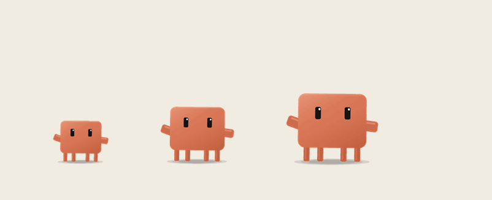

</div>

## 看一看

### 跟着 AI 干活

AI 做什么，大的就做什么：读文件拿放大镜，改代码敲键盘，跑命令看终端，查资料举望远镜。最小的举着小黑板播报进度，做完了还写上用了几分钟。

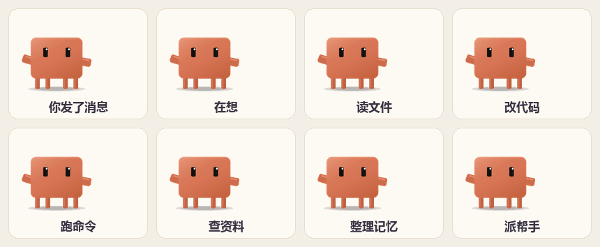

### 几个对话一起盯着

每个对话一个小圆圈：蓝色在忙，橙色等你，绿色做完。鼠标停上去看是哪个对话，点一下就跳过去。

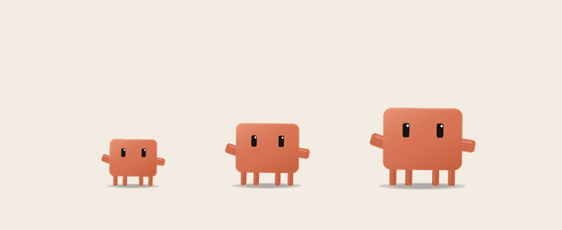

### 翻宝贝

AI 干活时，小的会蹲下刨土。翻到了先举起来亮一下，这一轮做完再捧去交给大的。一共 28 件，也可以从右键菜单让它们亲手翻。

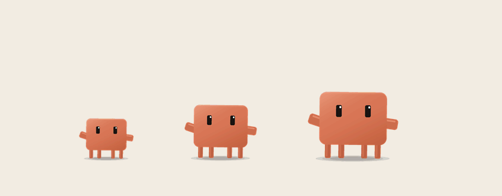

每件宝贝都能拿出来玩，稀有和特殊的每件都有自己的玩法。

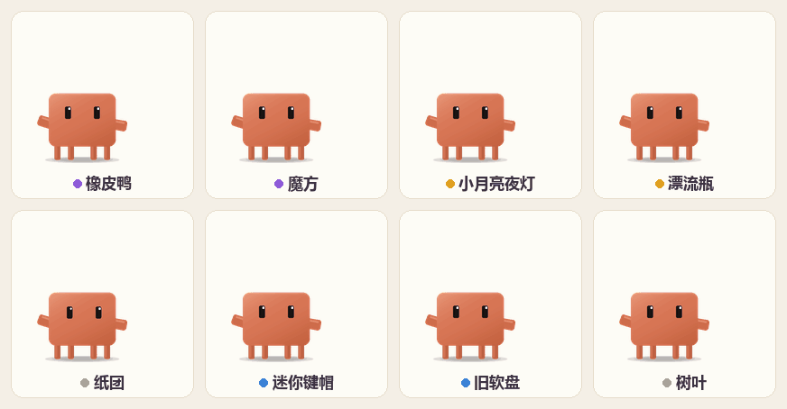

### 一家三口自己玩

闲着时它们会击掌、叠罗汉、跳山羊、排排走、传纸条……想看哪个，右键菜单点一下。

<table>
<tr>
<td align="center">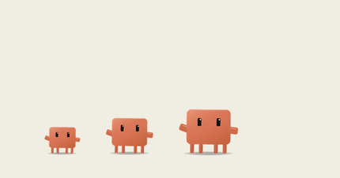<br>击掌</td>
<td align="center">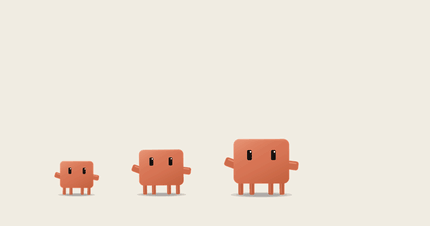<br>叠罗汉</td>
</tr>
<tr>
<td align="center">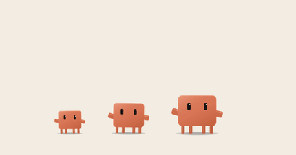<br>跳山羊</td>
<td align="center">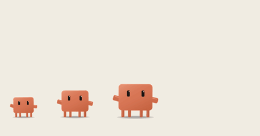<br>排排走</td>
</tr>
</table>

### 升级和图鉴

全家一起升级，3 到 20 级一路有礼物：粉笔颜色、牌子外框、第二批宝贝等。见过的都收进图鉴，没见过的是剪影，点开是一句谜语。

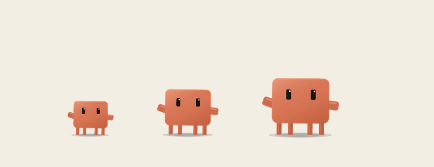

<table>
<tr>
<td>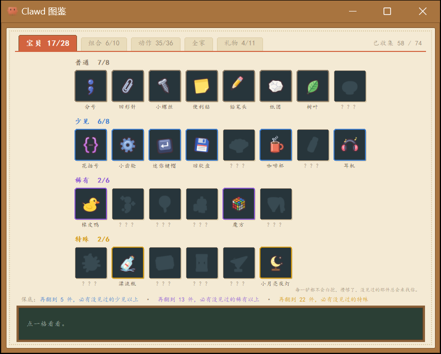</td>
<td>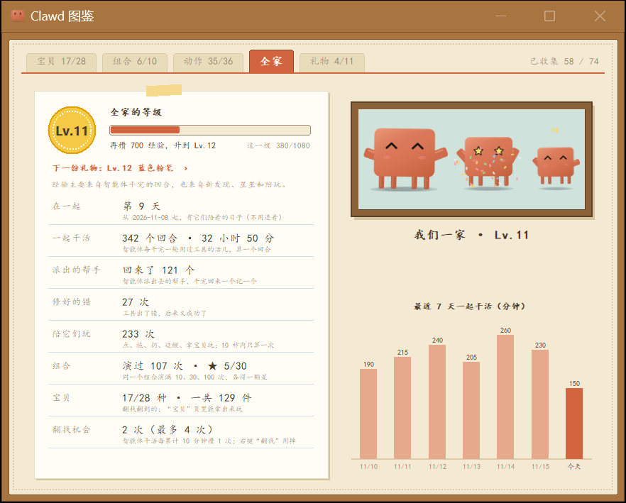</td>
</tr>
<tr>
<td>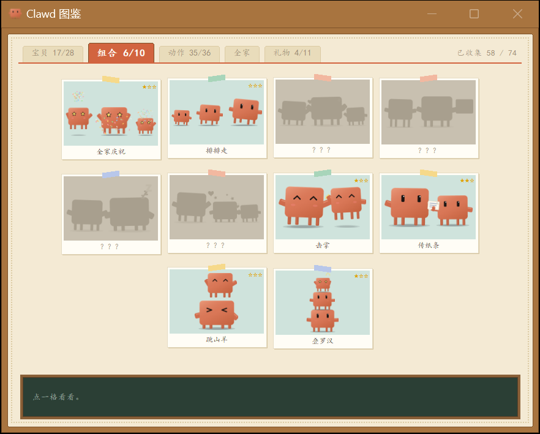</td>
<td>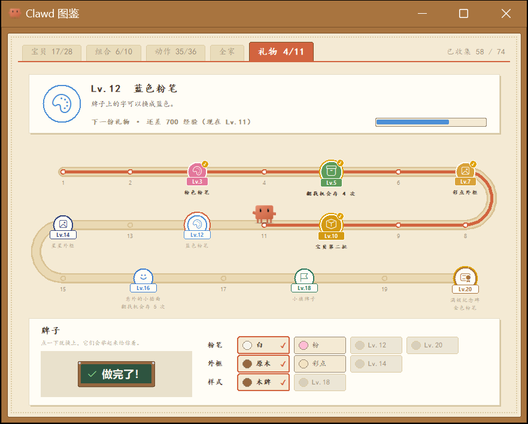</td>
</tr>
</table>

### 连接 AI 只要勾一下

第一次启动会弹出“连接 AI”窗口，用过的 AI 已经勾好，点“应用”就行。其他设置都在右键菜单里。

<table>
<tr>
<td>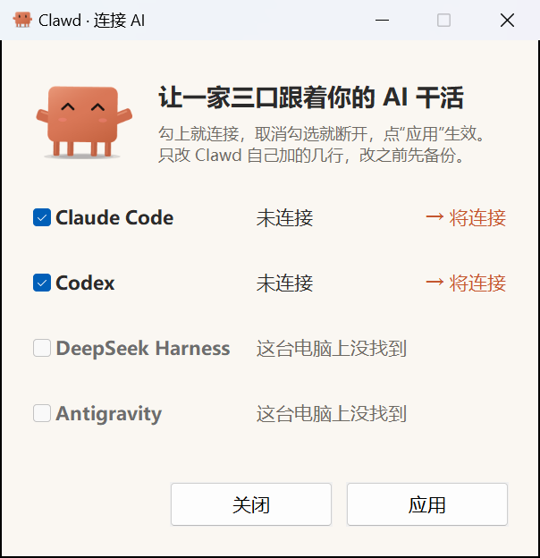</td>
<td>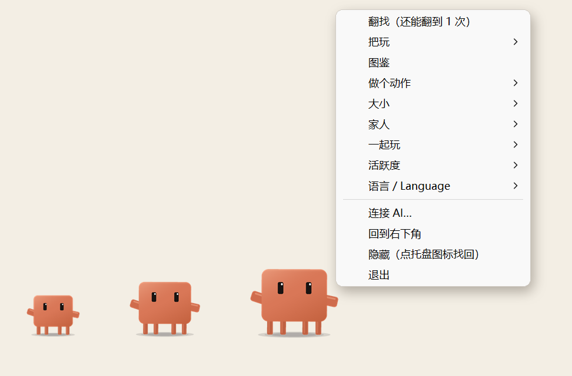</td>
</tr>
</table>

### 很轻

不调用模型、不联网，不耗 AI 额度。只记“在读文件”“在跑命令”这类状态，不记命令、文件名和你说的话。空闲时 CPU 约 0.06%，内存约 50 MB。

---

下面是完整的说明书：怎么装、所有功能、和 AI 是怎么连上的。

只想知道怎么玩：看[游玩手册](GUIDE.md)。本文档描述 `main` 分支的当前版本。

- [使用教程](#使用教程)
- [全部功能](#全部功能)
- [Hook 是怎么连接的](#hook-是怎么连接的)
- [文件和运行数据](#文件和运行数据)

## 使用教程

### 安装

下载 `RedCrab-Setup-<版本>.exe` 运行就行：自带 Python，不用另装别的，不要管理员权限。装到哪里可以自己选（哪个盘都行），默认在 `%LOCALAPPDATA%\Programs\RedCrab`；安装时选“为所有用户安装”就要管理员权限，可以装进 Program Files。装完会启动，开始菜单里有“红螃蟹”。

- **升级：** 直接运行新版的安装包，会装回原来的位置，先让桌宠退出，装完再启动。存档和已经连好的 AI 不受影响。
- **挪位置：** 先卸载再装到新位置，存档不会丢。
- 安装包没有数字签名，Windows 可能弹出“Windows 已保护你的电脑”：点“更多信息”→“仍要运行”。
- **Mac、Linux：** 暂不支持，欢迎拿源码自己移植。动作帧、美术、养成和 hook 都能直接用，要改写的是 Windows 专用的部分：桌宠窗口、托盘图标、找对话窗口和点圆圈跳过去。

### 从源码运行

- Windows。
- Python 3.12（64 位，带 Tk）。播放器只用标准库；`tools\` 里的测试按 Python 在 `C:\Python312` 写的。
- 帧目录 `frames\`、`frames_hi\`。它们不进 git，要用渲染器生成，渲染器依赖 `requirements.txt`（numpy、pillow），装在 `.venv` 里：

  ```bash
  python -m venv .venv
  .venv/Scripts/python.exe -m pip install -r requirements.txt
  .venv/Scripts/python.exe prerender.py --body-px 100 --out frames --no-preview
  .venv/Scripts/python.exe prerender.py --body-px 300 --out frames_hi --no-preview
  ```

- 启动：`python clawd.py`（第一次启动会弹出“连接 AI”窗口）。

- 下面的命令以代码放在 `E:\clawd`、Python 在 `C:\Python312` 为例，换成你自己的位置就行。程序里的路径都按自己所在的位置推，放在哪个文件夹都能跑；挪之前先对装过的每家 `hooks off`，挪完再 `on`。

### 连接 AI

**最简单：用连接窗口。** 第一次启动时，大的举一块“右键点我有菜单”的牌子，同时弹出“连接 AI”窗口：勾上就连接，取消勾选就断开，点 `应用` 生效。第一次打开时，这台电脑上用过的 agent 都已勾好；勾选和现在不一样的，旁边写着“将连接”或“将断开”。应用后每一家下面写着结果和还差哪一步（Codex 要在它的设置里信任这些 hook，DeepSeek 要重启一下），窗口不关，可以接着改。没装的灰着。以后随时从右键菜单或托盘菜单的 `连接 AI…`，或 `clawd connect` 打开它再改。它和下面的命令做的是同一件事：只动我们加的那几行，改之前先备份。

**也可以用命令。** 比如在 Claude Code 里运行下面这条命令，只需一次：

```
! C:/Python312/python.exe E:/clawd/clawd.py hooks on
```

它会先备份 `~/.claude/settings.json`，再加入 17 个 hook（每个写一个动作词，你发消息和对话开始时顺带记下对话在哪个窗口）。已经打开的会话也会生效。

**接其他 agent：** 四家共用同一家桌宠，各装各的，`clawd hooks on <agent>` 装、`off <agent>` 卸（只动我们加的那部分，改之前先备份），`clawd hooks status` 一次看四家装没装。

| agent | 装法 | 装到哪里 | 显示不了的 | 点圆圈 |
|---|---|---|---|---|
| Claude Code | `clawd hooks on` | `~/.claude/settings.json`，17 个 hook | —— | 桌面端切到那个对话；Windows Terminal 切到那个标签；其他终端切到窗口 |
| Codex | `clawd hooks on codex`，再在 Codex 里信任（命令行 `/hooks`，桌面版 设置 > Hooks） | `~/.codex/hooks.json`，12 个 hook | 读文件、查网页、工具出错、它自己的后台任务（不算你的对话） | 桌面版切到那个对话；终端里切到窗口 |
| DeepSeek Harness | `clawd hooks on deepseek`，重启 DeepSeek | 插件 `clawd_dsh.mjs`（`~/.dsh/profiles/desktop/cordis.patch.yml` 末尾加一段加载它） | 整理记忆 | 切到它的窗口（没有打开某个对话的链接） |
| Antigravity | `clawd hooks on antigravity`，新开的对话生效 | `~/.gemini/config/hooks.json` 里的 `"clawd"` 一项，4 个 hook | 等你回复、派子智能体出发、整理记忆、对话结束；动作在工具做完时才出现 | 切到它的窗口（同上）；关到托盘时叫回来 |

**hook 只听不拦：** 不管哪家，我们的 hook 和插件都只往事件文件写一个词，不放行、不拒绝、不往对话里加东西，出错也不连累 agent。Claude Code、Codex 的 hook 在后台跑（`async`），agent 不等它们；DeepSeek 的插件把它能拦的事件一律原样放行；Antigravity 会等每个 hook 的回答，所以只挂不用表态的 4 个、一律回 `{}`，程序文件夹或 Python 不在时由 `cmd` 自己回 `{}`。Antigravity 工具开始前的 hook 不挂：它把不表态当成拒绝，会拦下所有工具。挪走或删掉这个文件夹前，先对装过的每家 `hooks off`。

### 命令

下面的 `clawd ...` 是 `python clawd.py ...` 的简写：从源码运行时是 `C:/Python312/python.exe E:/clawd/clawd.py ...`（可以在 PowerShell 配置文件里定义一个 `clawd` 函数）；装的版本是安装目录里的 `python\python.exe clawd.py ...`。

| 命令 | 作用 |
|---|---|
| `clawd` | 启动，只数和上次一样；已经在运行但被隐藏了，就显示出来 |
| `clawd 1` / `2` / `3` | 立刻切换只数；没在运行时会启动 |
| `clawd off` | 全家退出，大小和只数记住；下次启动全家在右下角 |
| `clawd hide` / `show` | 全家隐藏 / 显示出来（同点托盘图标） |
| `clawd size 150` | 全家按比例一起变大变小 |
| `clawd size` | 查看当前大小 |
| `clawd do <动作>` | 播一个动作或组合，比如 `clawd do 击掌` |
| `clawd do 把玩 [宝贝]` | 拿一件收集到的宝贝出来玩，不写宝贝就随便拿一件 |
| `clawd list` | 列出所有动作和组合 |
| `clawd status` | 查看是否在运行、是否隐藏，以及全家的等级（见“养成”） |
| `clawd circles` | 列出对话圆圈：每个是哪个对话、在桌面版还是终端、点了会去哪（跳不过去时先看它） |
| `clawd activity quiet` / `normal` / `lively` | 活跃度：安静 / 正常 / 活泼；不带参数显示现在的 |
| `clawd autostart on` / `off` | 开机自启开 / 关（同托盘菜单的 `开机自启`）；不带参数显示现在的状态 |
| `clawd lang en` / `zh` | 切换界面语言（英文 / 中文）；不带参数显示当前语言 |
| `clawd hooks on` / `off` / `status` `[claude\|codex\|deepseek\|antigravity]` | 安装、卸载、查看 hook（DeepSeek 是插件）；不写 agent 就是 Claude Code |
| `clawd connect` | 打开“连接 AI”窗口（同右键菜单、托盘菜单的 `连接 AI…`） |
| `clawd hooks refresh` | 我们的 hook 指着别的地方（程序挪过位置）时，改成指这一份；装好的版本每次启动自动做 |
| `clawd uninstall` | 卸载用：退出，去掉四家的 hook 和这一份的开机自启；存档留着，说在哪 |

界面有中文和英文两种。右键菜单的 `语言 / Language` 和 `clawd lang` 命令都能切换，切换后右键菜单、动作名、命令行提示都跟着变，`clawd do` 中英文名都认（如 `clawd do high five`）。选择会记在 `state.json` 里，重启后不变。还没选过时跟系统：中文 Windows 用中文，其他用英文。

### 鼠标

| 操作 | 反应 |
|---|---|
| 单击 | 挥手或小跳 |
| 双击 | 庆祝 |
| 2 秒内点 3 下 | 害羞 |
| 鼠标移上去 | 看向你（最多 10 秒一次） |
| 鼠标停在某一只附近（3 个身长内）不动 | 鼠标小剧场：离得最近、闲着的那只 3 秒时朝鼠标那边看过来，5 秒时朝鼠标走近半个身长（不出自己的活动范围），8 秒时坐下打瞌睡（头一点一点，鼻涕泡变大又破）。鼠标在它附近动或从它身上划过，它就惊醒，冒个“!”，15 秒内不再来一次；在远处动鼠标它接着睡，约 40 秒后自己伸懒腰站起来。一直不动到全家该睡觉时，它就慢慢真睡着了 |
| 拖动 / 松手 | 被拎起来 / 落地；靠近屏幕边缘时滑过去贴边 |
| 拖着快速一甩、趁还在动时松手 | 被扔出去：在空中翻跟头，碰到屏幕两边和顶上会弹回来，落到底部弹两下，坐着晕乎乎冒星星，再站起来；附近的家人跑过来拍拍它。飞的时候点住能接住，只点一下它就接着往下掉 |
| 把一只拖到另一只身上松手 | 击掌；放到比它大的那只头顶上是叠罗汉 |
| Ctrl+滚轮 | 全家一起变大变小 |
| 右键 | 菜单 |

**右键菜单：**

- `翻找（还能翻到 N 次）`：让点的那只翻找，见“翻找和宝贝”
- `把玩`：拿一件收集到的宝贝出来玩（还没有宝贝时是灰的）
- `图鉴`：打开图鉴（有新东西时写着几个新）
- `做个动作`：手动播任意动作
- `大小`：调全家大小，低于下限的选项是灰色
- `家人`：切换一只、两只、三只
- `一起玩`：击掌、全家庆祝、凑过来看、拱醒、排排走、一起安慰、叠罗汉、传纸条、跳山羊
- `活跃度`：安静 / 正常 / 活泼（托盘菜单里也有），见下面
- `语言 / Language`：中文 / English
- `让它先回去`：只有小的有，只关这一只
- `回到右下角`：全家回去
- `隐藏（点托盘图标找回）`：全家藏起来
- `退出`：全家退出

窗口透明的部分点击会穿透到下面的软件，桌宠也不会抢键盘焦点。

**活跃度**是它们自己找事做的频率：小动作、散步、自己开始的组合、大的工作时小的跟着学、围观和自己玩。`安静`时小动作和散步的间隔约是正常的 2 倍，而且不自己开始任何组合，大的工作时小的也不跟着学、不围观、不自己玩；`活泼`时间隔约是正常的 0.6 倍。闲着时自己掏宝贝出来玩：正常约 6 分钟一次，安静约 12 分钟，活泼约 3 分钟。自己玩、跟着学、围观这几样“看点”之间至少隔 20 秒（安静 40 秒、活泼 12 秒），不会扎堆。工作动作、举牌、对回合结束和出错的反应，以及你主动让它们做的（点、拖、菜单、`clawd do`），三档都一样。选择记在 `state.json` 里。

### 托盘图标

任务栏右下角有一个 Clawd 小图标（Windows 11 默认可能收在 `^` 里，可以拖出来）。

- **左键点一下：** 全家隐藏，再点一下显示出来。隐藏时图标变淡。
- **右键：** `隐藏` / `显示`、`回到右下角`、`图鉴`、`活跃度`、`连接 AI…`、`开机自启`（打勾就开）、`去看看新版本`（用浏览器打开 GitHub 的发布页；桌宠自己不联网，不会自动检查）、`退出`。

**开机自启默认是关的。** 打开后只在当前用户的启动项（`HKCU\...\CurrentVersion\Run`）里加一条 `Clawd`，开机时按上次的只数和大小出现在右下角；取消勾选就删掉，连任务管理器里的禁用标记一起删干净。在任务管理器的「启动应用」里禁用了它，菜单里也会显示为没勾。

隐藏时不画动画，只在后台接着收 agent 的事件，CPU 比显示时还低；显示出来时直接是现在的状态（比如大的正在工作，就是工作动作；还在等你回复，牌子会重新举起来）。`clawd do` 一个动作或组合时会自动显示出来。重启后总是显示的。

### 关闭和卸载

- 关闭：右键 `退出`、托盘图标右键 `退出`，或 `clawd off`。不想看到又不想关，就点托盘图标隐藏。
- 断开某一家：在“连接 AI”窗口里取消勾选，或 `clawd hooks off`（Claude Code）、`clawd hooks off codex` 等。只删除我们加的那部分，其他 hook 不动。
- 全部去掉：装的版本在 Windows 的“设置 → 应用”里卸载“红螃蟹”：会先退出，去掉四家的 hook 和开机自启，再问要不要把存档也删掉（默认不删）。从源码运行的用 `clawd uninstall`，存档留着。

## 全部功能

### 一家三口

- **默认一只，最多三只：** 一个进程管多个窗口。
- **比例固定：** 100%、80%、60%，全家一起缩放。
- **大小范围：** 大的最大 300%。最小那只到 50% 时全家一起停，所以大的最小值是一只 50%、两只 63%、三只 84%。只数变少时恢复你原来设的大小。
- **分工：** 大的显示工作状态，小的负责情绪。

### Claude 工作时

**大的按实际状态播放：**

| Claude 在做什么 | 动作 |
|---|---|
| 你发消息 | 认真听 |
| Read、Grep、Glob | 放大镜 |
| Edit、Write、NotebookEdit | 打字 |
| Bash、PowerShell | 终端 |
| WebSearch、WebFetch | 望远镜 |
| 工具结束 6 秒后 | 想一想 |
| 压缩上下文 | 整理记忆 |
| 子智能体开始 / 结束 | 纸飞机 / 点头（有小的时，小的把结果纸条送过来，大的边工作边看） |
| 工具失败 | 吓一跳；60 秒内再失败播困惑 |
| 等你授权或收到通知 | 看向你、挥手轮流，最多 2 分钟 |
| 对话开始 / 结束 | 挥手 |
| 回合出错结束 | 摊手流汗 |

每个工作动作至少播 2.5 秒，切换太快时只显示最新的。工具结束后动作再留 6 秒才切到想一想，这样很快结束的工具（比如搜索）也看得到；期间有新工具或回合结束，就马上切换。

**回合结束时：**

| 回合时长 | 大的 | 小的 |
|---|---|---|
| 不到 20 秒 | 小跳 | 一只小跳 |
| 20 秒到 2 分钟 | 点赞 | 两只依次小跳，30% 概率接一次击掌，15% 概率接一次叠罗汉 |
| 超过 2 分钟 | 庆祝 | 跑到大的身边一起庆祝 |

**小的其他反应：** 你发消息时一只看向你；子智能体开始时一只踮脚看；子智能体结束时一只小的把纸条送给大的（30 秒内最多一次，其余的点头）；工具第一次出错一只吓一跳，连续出错时走过去安慰；提问时一只挥手；回合出错时也走过去安慰；对话开始和结束时都挥手。同一事件 3 秒内不重复，读文件、跑命令这类高频事件不转告。

**举牌：** 最小的那只当“解说员”，举起一根木棍，棍子顶上是一块木框小黑板，写着 Claude 在做什么，前面有彩色小图标。

| 发生了什么 | 牌子 | 举多久 |
|---|---|---|
| 开始读、改、跑命令、查资料 | 在读文件 / 在改代码 / 在跑命令 / 在查资料 | 约 3 秒 |
| 派子智能体 | 派了帮手 | 约 3 秒 |
| 想了很久没用工具（你发消息后或上个工具结束后，大的“想一想”满 8 秒） | 在想… | 约 4 秒，还在想就每 30 秒再举一次 |
| 压缩上下文 | 整理记忆中 | 压缩期间一直举着 |
| 回合结束 | 做完了！用了 3 分钟 | 约 4 秒 |
| 等你回复或授权 | 等你回复 | 一直举着，直到你回复（最多 2 分钟） |
| 回合出错结束 | 出错停下了 | 约 4 秒 |

- **不来回闪：** 同一种工具连着用只举一次；举着时换了工具就直接换字；放下后 4 秒内不为工具再举。回合结束、等你回复、出错随时会举，也会盖过工具的牌子。
- **谁举：** 最小的、手上没事的那只；它在忙别的（做组合、被拖着、鼠标小剧场里、跟着学、做你点的动作）时换另一只小的，两只都忙就浮在大的头上。只有一只，或者回合出错（小的要过去安慰）、长回合结束（小的要过去一起庆祝）时，牌子浮在大的头上，大的照常干活。被拖远的小的照样原地举。
- **衔接：** 棍子从待机姿势举起、放回待机姿势；牌子在棍子举到顶后才淡入，放下前先淡出。举牌的那只不散步、不做随机小动作、不跟着学，回合结束也不跳（别的小的跳）。拖它、从菜单点组合都会先收牌。
- **字是播放器现画的：** 按举牌那只的大小定字号（最小 12 像素，保证看得清）；跟着菜单的语言，举着牌时切换语言，字马上跟着换。牌子窗口点击会穿透，不挡你点后面的东西。

**大的工作时，小的更安静，但有事做：**

- 不随意走路，随机小动作减半，也不睡觉。
- **跟着学：** 大的读文件、打字、跑命令、查网页满 4 秒后，一只小的偶尔学约 3.5 秒，每 20–45 秒最多一次，不跟着切换。
- **围观：** 大的跑命令或查网页满 15 秒（其他工作满 45 秒），一只小的走过去踮脚看，留到工作结束。同一时间最多一只，隔 45–90 秒才可能再来。
- **两只小的自己玩：** 有三只时，大的工作满 30 秒后，两只小的每 2–4 分钟自己玩一回：跳山羊（45%）、击掌（35%）或传纸条（20%），不叫大的，就在原地附近。玩完走回原位。有一只在围观或举牌时不开始。

### 待机时

| 动作 | 频率 |
|---|---|
| 呼吸 | 一直 |
| 随机小动作：眨眼、看向你、踮脚看、小跳、叉腰 | 每只每 6–15 秒一个 |
| 走路，只在自己的地方左右各约 1.2 个身长内，碰到屏幕边缘或另一只会转身 | 每只每 30–70 秒，一半概率 |
| 击掌（22%）、排排走（17%）、跳山羊（15%）、叠罗汉（13%）、传纸条（13%）、一起安慰（12%）或全家庆祝（8%） | 都闲着时每 2–4 分钟一次 |
| 全家睡觉 | 5 分钟没有互动 |
| 拱醒 | 全家睡着 4–12 分钟后，一半概率 |

从睡觉醒来都先播约 1 秒的“醒来”。例外是直接左键点睡着的那只，或调大小，这时是吓一跳。

小剧场从它看过来那一刻就算开始，到惊醒为止，这期间别的事尽量不打扰它：举牌、回合结束的“跳一下”、出错安慰、送纸条、跟着学、围观、自己玩都改找别的家人，没有别的就算了（牌子浮在大的头上）。只有这些会叫醒它，而且先惊醒再做：大的开始工作（它就是大的时）、你点它或从菜单点组合、长回合结束的全家庆祝、升级庆祝（离大的太远的照样睡）。被拎起来或扔出去时直接醒。右键菜单 `做个动作` 里的 `打瞌睡` 和 `clawd do 打瞌睡` 也能让它打个盹：约 8 秒后自己伸懒腰站起来，这时动鼠标不会叫醒它。

### 组合动作

| 组合 | 怎么演 | 自动触发 |
|---|---|---|
| 击掌 | 小的走向大的，跳起来和它碰手，星星炸开（大的在工作时是两只小的击掌） | 待机；中等回合结束后偶尔；两只小的自己玩 |
| 全家庆祝 | 小的走到大的两边，依次庆祝 | 待机；长回合结束 |
| 凑过来看 | 一只小的走到大的旁边，踮脚看 | 大的跑命令或查网页满 15 秒，其他工作满 45 秒 |
| 拱醒 | 另一只走过去，拱两下，睡着的那只起来并点头 | 全家睡着一段时间后 |
| 排排走 | 小的排到大的身后，一起走一段，一起转身走回来，这时最小的领头 | 待机 |
| 一起安慰 | 小的走到大的两边轻拍三下，飘小爱心，大的点点头。大的不用停下工作 | 工具连续出错；回合出错；待机 |
| 叠罗汉 | 大的站稳当底座，小的一只只跳上去（三只时最小的在最上面），最上面的欢呼，再从上往下跳下来 | 待机；中等回合结束后偶尔；把小的放到大的头顶上 |
| 传纸条 | 一只小的掏出纸条，举着走过去递给大的（待机时偶尔递给另一只小的），对方接过来看一看再收好 | 子智能体结束（大的不用停下工作）；待机；两只小的自己玩 |
| 跳山羊 | 大一点的蹲下缩成一团，小一点的从它头顶跳过去；再换过来跳一次，两只一起往前挪两步。三只时是两只小的玩，两只时是大的和小的（大的跳完马上走回原位）。往离你放它们的地方近的一边跳 | 待机；两只小的自己玩 |

**走过去：** 组合开始时，一只小跑到另一只身边，最多约 1.3 秒（拱醒最多 2.6 秒）；组合结束后走回原位、被挤开时也快步走，最多 4.5 秒。腿的节奏跟着速度加快。排排走的速度不变。

**离得远就不自己凑：** 它们自己开始的组合（待机、回合结束、出错安慰、递纸条、围观、拱醒、两只小的自己玩），离大的超过约 4 个大的身长的那只不参加，近的照样玩；任何一只要走的路也不超过这个距离，不会横穿屏幕。你从菜单、`clawd do` 或拖到身上开始的不受限制。

**优先级从高到低：** 你的操作 > 工作状态和提问 > 组合动作 > 平时的小动作和走路。

**翻找被叫走：** 你拖它、给它点别的动作，或者（大的）来了新的工作事件，它先站起来、土坑合上，再去做别的；没翻出结果的不算，也不扣机会。

**什么会打断组合：** 只有你给它们下了新指令才打断：拖走参加的那只（或大的）、从菜单给参加的那只点一个动作、点另一个组合、改大小或只数、隐藏；另外，Claude 开始工作或提问时，大的会退出。鼠标悬浮、打开右键菜单（点在哪只上都一样）不打断。叠罗汉是例外：戳一下塔就倒。

**什么算一次：** 组合演到最后才算（新发现、次数和星星、亲手组合的经验都按这个）；被打断的不算。

**结束后：** 小的 3–7 秒后走回组合前的位置（大的工作时也一样；只有过来围观的那只留到工作结束）。你拖过的那只不走回；拖到身上击掌或叠罗汉的留在原地。

**打断规则：** 拖动参加的那只或拖动大的、调大小、切换只数，都会取消组合。大的参加时来了工作事件，也会取消，大的马上去工作。正在播的一次性动作不会被切断，只有叠罗汉和跳山羊例外：取消时上面的马上跳下来（调大小、切换只数时直接回到地面；跳山羊跳到一半时直接落到要落的地方），点一下叠罗汉里的任何一只也会让它们下来。

### 养成

全家共用一个等级，经验只有一个池子：Claude 干活涨得多，陪它们玩涨得少。没有每天的上限。

| 怎么得经验 | 经验 |
|---|---|
| 一个回合结束（用过工具、没出错停下；中途插话还是同一个回合） | 5，这个回合每干 1 分钟活再加 2（按干活时间，不封顶） |
| 回合里工具出错后又成功了（每回合一次） | 5 |
| 子智能体做完回来 | 3 |
| 第一次看到某个组合演完 | 20 |
| 第一次看到 9 种特殊动作里的一种 | 10 |
| 同一个组合演满 10、30、100 次（一颗、两颗、三颗星） | 10、15、30 |
| 亲手促成的组合（拖到另一只身上击掌、放到头顶叠罗汉、扔出去后被拍拍） | 3，1 分钟内只算一次 |
| 第一次捡到某件宝贝 | 20（重复的只计数） |
| 点、拖、扔、把打盹的叫醒 | 1–2，10 秒内只算一次 |

没用工具的回合不算。升到下一级要的经验越来越多：Lv.1→2 要 40，Lv.2→3 要 113，Lv.3→4 要 208。

- **升级：** 等回合结束的反应演完、大的闲下来，全家庆祝（只有一只时大的自己欢呼），举起金色的牌子“升级啦！Lv.N”，下面一条进度条写着离下一级还差多少，约 6 秒。最高 20 级（满级），正常用大约半个月到：前几级很快，10 级以后大约一天一级。
- **等级礼物：** 到 3、5、7、10、12、14、16、18、20 级各有礼物，升级牌放下后举粉色的礼物牌“礼物：……”：粉笔颜色（粉、蓝、金，牌子上字的颜色）、牌子外框（彩点、星星）、小旗样式的牌子、翻找机会能多存（4 次、5 次），还有宝贝第二批、意外的小插曲（16 级起，击掌偶尔扑个空、跳山羊偶尔一个跟头滚过去、叠罗汉偶尔翻着跟头下来，第一次碰上算新发现）；20 级的礼物见下面折起来的部分。更新前已经到了的等级，第一次启动时一份份补发（“补发：……”）。下一份礼物在图鉴“礼物”页、全家页、托盘提示和 `clawd status` 里都写着。
- **新发现：** 一个组合第一次演完，举起薄荷绿的牌子“新发现：组合名！”，约 5 秒。自己发生的、你亲手摆出来的、菜单点的都算。
- **特殊动作：** 害羞、被拎起来、被扔出去、晕乎乎、打瞌睡、一激灵、伸懒腰起来、摊手流汗、吓一跳，这 9 种第一次出现也举“新发现”牌。其他常见动作只悄悄记下，不举牌。
- **星星：** 每个组合都记次数，谁发起的都算。演满 10、30、100 次各得一颗星，举牌“击掌 ★ 熟练了！”。
- **组合不分谁来演：** 图鉴里的组合都是你自己能点出来的：右键菜单“一起玩”里的 9 个，加上扔完拍拍。谁参加、谁发起的都算同一个，想刷星星就多点几次。
- **翻找和宝贝：**
  - **干活时间：** 翻找和经验都按 AI 真在干活的时间算，不按回合数：从你发消息开始算，等你批准或回复（橙色圆圈）的时候不算，5 分钟一点动静都没有也不算（除非它有个命令还在跑），回合结束后后台帮手的活不算。只聊天、没用工具的回合不算。几个对话同时干活时：小的自己翻和经验，每个对话各算各的（各有各的次数上限）；亲手翻的机会只算一份，几个对话同时干 10 分钟也只给 1 次。
  - **它自己翻：** 一个回合用过工具后，这个回合每干满 2 分钟活，一只闲着的小的会蹲下，在面前刨个土坑翻找（土会溅到脸上，翻完站起来甩一甩），十次里四次翻到；一个回合最多翻的次数等于现在能存的翻找机会（3 次，5 级起 4 次，16 级起 5 次）。翻到了就举起来亮一下再收好；没翻到会失落一会儿。回合结束、“做完了”的牌子放下后交宝贝，牌子写“捡到了：橡皮鸭（稀有）”：普通的，它原地举出来给你看；少见以上的，它捧着走到大的身边递过去，大的接住举高，另一只小的从另一边凑过来看；稀有和特殊的，递完全家再欢呼一下。一个回合翻到好几件就一件件交。宝贝从它迈步那一刻就算你的：半路被你拖走、新的回合开始了，只是不演了，牌子照举（没递出去的，它有空就原地举一下）。收着的宝贝当场写进存档，回合中途退出，下次启动时补给你。到时候没有小的能去翻（比如只有一只，或小的一直在打盹），欠着的几次回合结束时由大的从身后掏，机会一样。
  - **你让它翻：** 右键菜单“翻找”，或 `clawd do 翻找`（大的翻）。三只都能翻，当场出结果。宝贝来自干活：干活时间每累计满 10 分钟，马上攒 1 次“能翻到”的机会，回合中途也给，多出来的时间留着接着攒；最多存 3 次（5 级起 4 次，16 级起 5 次），存满了就不再攒，用掉再攒；菜单上写着还剩几次；新的一家一开始就有 2 次。有机会时十次里六次能翻到；挖完出结果就用掉一次，翻到没翻到都算，但空手一次后下一次亲手翻一定翻到（挖到一半被叫走的不算）；机会用完了照样能翻着玩，只是空手。它翻的时候点它一下是帮它翻：它一激灵、举一下双臂，接着挖得更快、土更多，剩下的时间减半，更容易翻到、也更容易出好的。
  - **它自己翻的，一个回合最多出一件；你亲手翻的另算**，只看还有没有机会，两边互不影响。
  - **稀有度（亲手翻和它自己翻一样）：** 每翻到一件，普通 62%、少见 25%、稀有 9%、特殊（金色）4%。保底：连着 8 件没翻到新的少见以上，下一件必是没见过的少见以上；稀有 20 件、特殊 40 件同理。翻到已有的不清零保底，运气不会白白用掉；某个稀有度以上都集齐了，那一档保底就不再显示。图鉴宝贝页底下只写保底（再翻到几件必有没见过的什么），概率不用记。平时还没有的比已有的容易出（两倍）。举起来时身后的光是稀有度的颜色：普通淡白、少见蓝、稀有紫、特殊金。
  - **特殊宝贝也跟干的活有关：** 它自己翻（或大的掏出来）时，回合里修好了错误、查过资料、整理过记忆、超过 20 分钟、派过帮手（到 Lv.10 后还有深夜），更容易翻到对应的那件特殊宝贝。
  - 首批 20 件：普通 8、少见 5、稀有 2、特殊 5；Lv.10 的礼物再加第二批 8 件（之前在图鉴里是锁着的剪影）。每件都有自己的小动作。
  - **把玩：** 收集到的宝贝可以拿出来玩。右键菜单“把玩”里选一件（或“随便拿一件”），点的哪只哪只玩；图鉴里点一件宝贝，再点“拿出来玩”；`clawd do 把玩 树叶`（不写宝贝就随便拿一件）。它从身后掏出来，玩一会儿再收回去，4 到 5 秒半。普通和少见的宝贝用四种玩法里固定的一种：凑近细看（看出点什么，点点头冒个小心心）、抛起来接住（第二下抛得更高）、贴在耳边摇一摇听、像奖杯一样举高左右晃。稀有和特殊的每件有自己的玩法（见下面折起来的部分）。闲着的时候它们偶尔也会自己掏一件出来玩（一次只有一只）。第一次捡到某件宝贝，亮完宝贝、牌子放下后，拿着它的那只会当场掏出来玩一次。你点的立刻生效，大的在干活时也能玩，玩完回去干活；玩的时候被拖走，宝贝马上收起来。

<details>
<summary>全部宝贝、稀有和特殊的玩法、20 级的礼物（剧透）</summary>

- **特殊宝贝也跟干的活有关：** 它自己翻（或大的掏出来）时，回合里修好了错误、查过资料、整理过记忆、超过 20 分钟、派过帮手（到 Lv.10 后还有深夜），翻到的东西有四成是对应的“被抓住的小虫”“漂流瓶”“压缩饼干”“沙漏”“纸飞机模型”（纸飞机这条路一天一次）；已经有了的是两成。没轮上的照常按上面的概率出。
- 首批 20 件：分号、回形针、小螺丝、便利贴、铅笔头、纸团、树叶、小石子（普通）；花括号、小齿轮、迷你键帽、旧软盘、贝壳（少见）；橡皮鸭、金色分号（稀有）；加上 5 件特殊的。每件都有自己的小动作。
- **第二批 8 件（Lv.10 的礼物，之前在图鉴里是锁着的剪影）：** 咖啡杯、U 盘、耳机（少见）；气球、发条小机器人、魔方、陀螺（稀有）；小月亮夜灯（特殊，深夜 23 点到 5 点的回合里自己翻更容易碰上）。
- **稀有和特殊的玩法：** 橡皮鸭放在脚边按得吱吱叫，金色分号对着光转、再像奖杯一样举高，压缩饼干往嘴里扔却咬不动、往头上磕把自己磕晕，漂流瓶拔塞倒出纸条读完再塞回去，沙漏横过来时间就停了（跳起来停在半空），小虫放飞绕一圈落回手上，纸飞机模型吹一口气翻个筋斗落回支架；第二批里，气球顺着长绳飘到头顶、把它带离地面一会儿，发条小机器人踏步、它跟着一起踏、发条走完一起停，魔方被它施了魔法、浮起来自己转到六面对齐，陀螺甩到脚边转起来、慢了就抽一鞭、三鞭抽得发光，小月亮夜灯的月亮浮到头顶、背后展开一片星空。
- **20 级的礼物：** 纪念碑。全家再庆祝一次，图鉴全家页立起一座纪念碑（石头台座），一家三口站在上面，下面的铜牌刻着出发和到达的日期、一起几天、干了多少回合、翻到多少宝贝，数字定格在满级那天。

</details>

- **图鉴：** 右键菜单或托盘菜单“图鉴”，或 `clawd album`。一本收藏册，五页：宝贝、组合、动作、全家、礼物（快捷键 1–5，Esc 关）。还没见过的是暗色剪影，点一下看密语提示，可以再要一句；见过之后密语留着，答案写在后面。选中的动作会在照片里动起来，组合的照片是参加的几只的合照。宝贝可以“拿出来玩”，组合和动作可以“让它们演一遍”。上次打开后新得到的东西是封着的（剪影加红点，标签页上也有红点），点一下才拆开。全家页写着等级、离下一级还差多少、经验从哪来、各项记录是什么意思，还有最近 7 天每天一起干活多少分钟、下一份礼物。礼物页是 1–20 级的路线：每份礼物一个徽章，点开看是什么、还差多少经验，小 Clawd 站在你现在的等级上；新得到、还没看过的礼物徽章上有红点（标签页和菜单里的“图鉴（N 个新）”也算它），打开礼物页先显示它，卡片上写着去哪儿看（宝贝第二批去宝贝页，小插曲看组合页的 ✧，20 级的礼物在全家页，牌子样式在下面换）；下面的“牌子”一栏换粉笔颜色、外框和样式，点一下桌面上的它们就举起新牌子给你看。窗口能拉大缩小、最大化，里面跟着缩放。图鉴是单独的进程，关掉就不占资源；它只读 `grow.json`（桌宠每分钟存一次，所以最新的可能晚一分钟），自己只写 `album.json`（看过哪些）。
- 养成的牌子让着工作的牌子：工作的牌子一举，它就让开。隐藏时不升级，显示出来再庆祝。
- 托盘图标的提示里有 `Lv.N`；`clawd status` 显示等级、进度条和回合数、一起工作的时长、帮手回来几次、修好几次错误、见过几个组合、几颗星、见过几种特殊动作、一起几天、有几种几件宝贝、还能亲手翻到几次。
- 数据存在 `grow.json`：运行时最多每分钟写一次，升级和退出时马上写。每天第一次写之前把前一天的文件复制成 `grow.json.bak`，`grow.json` 坏了就用它。同一个目录同时开两只桌宠（比如试用版）时，只有先开的那只写文件。日志里每个回合记一行时长和工具数，用来调升级速度。

### 前后和碰撞

- **前后：** 脚在屏幕上越低，越显得靠近你，显示在前面。把一只拖到另一只身后，它就留在那里，被挡住一部分。正被拖的那只永远在最前面。
- **不硬挡：** 拖动时不会被别的桌宠挡住。
- **碰撞：** 只有脚差不多高（站在同一排）又叠在一起才算撞上，约 2 秒后小的自己走开；没有空位就留在原地。走路时也只避开同一排的。
- **击掌：** 把一只拖到另一只身上，脚差不多高才击掌；脚差得多就当作摆到它身后。
- **叠罗汉：** 把小的放到比它大的那只头顶上（脚落在头顶附近），就叠罗汉，结束后跳到旁边。站在上面的那只显示在下面那只前面。跳山羊时在空中的那只也显示在前面。

### 活动范围、屏幕边缘和记忆

- **每次启动都在右下角：** 大的离右边和底边各 24 像素，小的排在它左边。中途多叫出来的也排到旁边。
- **你放哪儿，就在哪儿附近活动：** 每只自己走路只在你放它的地方附近（启动时是右下角），左右各约 1.2 个身长。拖到别处，就在新地方活动；被组合或碰撞带远了，会慢慢走回来。
- 身体不会跑出工作区，拖动时也一样。
- 松手时离边缘 16–48 像素，会滑过去贴边；调大小后继续贴着。
- 走到屏幕边缘会转身。超出身体的特效在边缘可能被切掉。
- 大小、只数、语言存在 `state.json`，下次启动恢复。位置也存着，但启动时不用（测试用 `--keep-place` 才按存的位置启动）。

### 资源占用

实测（24 逻辑核，占整机 CPU，2026-11-15）：三只、带对话圆圈，约 **0.06%**，专用内存约 **49 MB**（任务管理器里的“内存”是工作集，约 61 MB）。大小越大越高一点。

这些数字不含 hook 自身。单次 hook 约 55–100 ms。GPU 没有单独测过。

**不消耗任何 agent 的额度：** 桌宠不调用模型、不联网，hook 只是本机命令，不产生进入对话的内容。

## Hook 是怎么连接的

### 总体结构

Claude Code 和桌宠之间没有直接连接，也不走网络。它们只通过**一份配置和一个文件**联系。

```
CLI 对话 ────┐                                                     ┌→ 追加 “run 7b3befbc”
             ├→ 都读 ~/.claude/settings.json，到时机就运行 hook ───┤
桌面端对话 ──┘                                                     └→ 追加 “read 1a411b99”
                                                                             ↓
                                                                   %APPDATA%\Clawd\event
                                                                             ↓
                                                     桌宠每约 150 ms 检查一次，只有大的处理
```

- **Claude 主动：** hook 由 Claude Code 运行。打开桌宠不用向 Claude 申请，桌宠也不需要任何授权或账号信息。
- **互不依赖：** 桌宠没开时，hook 照常写文件，也不报错；关掉 hook 时，桌宠继续待机。
- **多个对话共用一家桌宠：** 本机所有读这份配置的 Claude Code 对话都写同一个文件。云端会话跑在别的机器上，按设计写不到这个文件（未实测）。

### 17 个 hook（Claude Code）

都是 `command` 类型的 exec 形式（直接运行 Python，不经过 shell，见下面“一条 hook 长什么样”），`async: true`，Claude 不用等它们。

| Claude Code 事件 | matcher | 写入的词 | 桌宠含义 |
|---|---|---|---|
| `UserPromptSubmit` | 全部 | `listen` | 你发了消息，开始忙 |
| `PreToolUse` | `Read\|Grep\|Glob` | `read` | 放大镜 |
| `PreToolUse` | `Edit\|Write\|NotebookEdit` | `edit` | 打字 |
| `PreToolUse` | `Bash\|PowerShell` | `run` | 终端 |
| `PreToolUse` | `WebSearch\|WebFetch` | `web` | 望远镜 |
| `PostToolUse` | 全部 | `think` | 工具结束，想一想 |
| `PostToolUseFailure` | 全部 | `fail` | 工具失败 |
| `SubagentStart` | 全部 | `agent` | 子智能体开始 |
| `SubagentStop` | 全部 | `agent_done` | 子智能体结束 |
| `PreCompact` | 全部 | `compact` | 开始压缩上下文 |
| `PostCompact` | 全部 | `compact_end` | 压缩结束，回到压缩前的状态 |
| `Stop` | 全部 | `stop` | 回合结束，按时长反应 |
| `StopFailure` | 全部 | `stopfail` | 回合出错结束 |
| `PermissionRequest` | 全部 | `attention` | 等你授权 |
| `Notification` | 全部 | `attention` | 通知 |
| `SessionStart` | 全部 | `hello` | 对话开始 |
| `SessionEnd` | 全部 | `bye` | 对话结束 |

其他工具的 `PreToolUse` 没有 hook，桌宠保持当前动作，这些工具结束时才有 `think`。

`SessionStart`、`UserPromptSubmit` 这两个还带 `--at`，顺带写一行 `at 会话ID 窗口句柄 claude`：这个对话在哪个窗口。窗口是从 hook 进程往上找到的第一个有可见窗口的祖先进程（终端、编辑器、Claude 桌面端），约 90 ms，每条消息一次。只记窗口句柄，不读窗口标题，也不看别的窗口。

### 对话圆圈

有对话干过活，大的脚边就出现带编号的小圆圈，一个对话一个：蓝色在忙，橙色等你（回合中等你批准或回答时一直是橙色，直到它下一步，不管等多久），绿色做完了，红色出错停下，灰色被你打断了（桌宠重启后、或很久没收到信号时，没结束的对话照样是蓝色：它可能还在想，30 分钟没动静才收起）。点一个圆圈，那个对话所在的窗口切到前面（最小化的会还原）。有两个以上对话时，牌子前面也带上编号（`② 做完了！`），一个对话时牌子不带。回合做完（绿）、出错停下（红）或被你打断（灰）一分钟后圆圈自己收起，下一条消息又出来，取最小的空号（号只表示先后，不跟着对话走）；对话结束（`bye`）、它的窗口关了、或闲着 30 分钟没动静也会消失；窗口直接没了（强制关掉、崩溃，或 Antigravity 这种不发结束信号的）时，那个对话的“在忙”也一起结束，大的不会白忙。鼠标停在圆圈上，上方显示“① 对话名 · 在忙/做完了/等你回复”，几家 agent 的圆圈同时在时，名字前面带上是哪家（“② DeepSeek · 名字 · 做完了”）；名字和 agent 里显示的一样，改了名马上跟着变（从 Claude 桌面端、命令行版、Codex 各自存对话名的文件里读，只读名字，只在鼠标停着时读；Codex 还没起名的新对话显示它的第一句话）。Codex 自己在后台跑的任务（比如整理记忆）也会触发 hook，但它不是你的对话，不给圆圈；Codex 的子智能体算在派它的那个对话上（都按 Codex 自己的对话列表 `state_5.sqlite` 认，只读）。能跳多准：Claude 桌面端和 Codex 里的对话能直接切到那个对话（用它们自己的 `claude://`、`codex://` 链接）；Windows Terminal 里的命令行版能切到它所在的那个标签：你在哪个标签发消息，就记住哪个标签（用 Windows 给标签的内部编号，你改了标签名也认得），点圆圈时选回它（`clawd_tabs.ps1`，约半秒）；VS Code 里的几个终端只能切到那个窗口；DeepSeek、Antigravity 都是一个窗口装下所有对话、没有打开某个对话的链接，只能切到它的窗口，窗口关到托盘时把它叫回来（程序还在托盘里跑，圆圈就留着）。全家隐藏、大的被拖着或扔出去时圆圈不显示。

**跳转不靠猜：** Claude 的对话在桌面版还是终端，由 hook 直接告诉桌宠（Claude Code 给 hook 的环境变量 `CLAUDE_CODE_ENTRYPOINT`），没有时看对话记录里写的 `entrypoint`；桌面版的对话拿到终端里 `/resume`（或反过来），圆圈跟着换。每种对话只有一条规则：桌面版开它的链接，Windows Terminal 切到它的标签，其他终端（包括 Git Bash 自己的窗口）拉它的窗口。关掉桌宠再打开，圆圈带着原来的号码和颜色回来（`talks.json`），点了照样能跳；关的时候它的窗口也关了的就不回来；这样回来的橙色圆圈 30 分钟没动静就收起（桌宠关着时那个对话做了什么，它不知道）。读标签用的 PowerShell 按固定位置找（不靠 PATH：从 Claude 桌面版启动的桌宠 PATH 里排第一的那个 pwsh 根本跑不起来），找不到 PowerShell 7 就用系统自带的 Windows PowerShell。Claude Code 的 Code Mode 把脚本结果交回给 Claude 时也会触发“你发了消息”的 hook，hook 认出来（`source` 是 `poll_event`）就不写，不会被当成新回合。

### 按 Esc 打断

Claude Code 被打断（Esc、停止按钮）时不发任何 hook（官方文档：`Stop` 在用户打断时不触发），不另想办法的话，大的要一直忙到你下一条消息或 10 分钟兜底。所以一个 Claude Code 对话在忙、却 15 秒没有任何事件时，桌宠每 5 秒看一眼它的对话记录（`~/.claude/projects/` 里的 `.jsonl`，只读最后 16 KB，只看最后一条消息是不是 Claude Code 写的“`[Request interrupted by user]`”）。是就当这回合被打断：大的安静地停下（不举“做完了”），圆圈变灰、写“被打断了”，一分钟后收起。想得久、命令跑得久、在等你批准时，最后一条都不是这行，照常在忙。Codex 点停止也不发 hook，看法一样：它的记录（Codex 对话表里的 `rollout_path`，只读最后 256 KB）里最后一个回合标记是 `turn_aborted` 就算被打断；你停下后马上又发了消息（最后是新的 `task_started`）就照常在忙。Antigravity、DeepSeek 点停止时会写 `cut`，不用看记录。

### 其他 agent：每家一张翻译表

桌宠只认事件文件里的词，不分是谁写的。`clawd.py` 的 `AGENTS` 里每个 agent 一张表：它的哪个事件、哪个工具对应哪个词。Codex 的表：`UserPromptSubmit`→`listen`，`PreToolUse` 的 `Bash`→`run`、`apply_patch`→`edit`，`PostToolUse`→`think`，`SubagentStart`/`SubagentStop`→`agent`/`agent_done`，`PreCompact`/`PostCompact`→`compact`/`compact_end`，`Stop`→`stop`，`PermissionRequest`→`attention`，`SessionStart`/`SessionEnd`→`hello`/`bye`。Codex 的 hook 在 Windows 上不一定跑在 bash 里，所以每个词都由 `clawd_hook.py` 写（只读输入开头的会话 ID）；它没有“工具失败”事件，读文件走 shell，所以没有 `fail`、`read`、`web`。

DeepSeek Harness 的表在插件 `clawd_dsh.mjs` 里，听的是它自己的事件（0.2.1）：新消息开始一步（`agent/pre-step`）→`listen`，工具开始（`tools/pre-execute`）的 `pwsh`→`run`、`read`/`glob`/`grep`→`read`、`edit`/`write`/`str_replace_editor`→`edit`、`web_fetch`/`web_search`→`web`，工具结束→`think`（出错→`fail`），回合结束（`agent/turn-stopping`）→`stop`，出错（`agent/error`）→`stopfail`，子智能体出发、回来→`agent`/`agent_done`，问你问题（`user-questions/request`）、请你批准（`approval/request`）→`attention`。你点停止时它不发专门的事件，插件看到回合没报结束就变回空闲（`agent/status`），写 `cut`（桌宠当成被你打断：停下、不举做完了、圆圈灰）。子智能体的工具算在派它的那个对话上。每条消息另写一行 `at 会话ID 0 deepseek`：DeepSeek 是单窗口应用，桌宠按程序名找到它的窗口。名字从 `~/.dsh/storages/session_projcache/sessions/session-<ID>.json` 的 `title` 读。DeepSeek（0.2.1）没有打开某个对话的链接，所以点圆圈只能切到它的窗口；窗口关到托盘时直接把它显示出来（DeepSeek 只是把窗口藏起来；`dsh://open` 要再起一个 DeepSeek 进程转达，约 2 秒），DeepSeek 没开时才用 `dsh://open` 打开它。DeepSeek 退出时插件给这次干过活的对话各写一个 `bye`，桌宠当场收工、收起圆圈。它的会话 ID 是 `session-` 加 UUID，取前缀后面的 8 位。以后 DeepSeek 若给其中哪个事件改了名，对应那一样就不再显示，不影响 DeepSeek 本身。

Antigravity 的表在 `clawd_hook.py` 的 `AG_TOOLS`（2.31）：每个事件只挂一个 hook、matcher 是 `*`，按工具名翻译。对话开始（`SessionStart`）→`hello`；它没有“你发了消息”的事件，`stop` 之后第一次调用模型（`PreInvocation`）算新回合→`listen`（`ag_turns.json` 记哪个对话在回合中，10 分钟没动静的当作已结束）；工具做完（`PostToolUse`）先写工具的词：`view_file`、`list_directory`、`grep_search`、`find` 等→`read`，`code_action`、`write_to_file`、`replace_file_content` 等→`edit`，`run_command`、`send_command_input` 等→`run`，`search_web`、`read_url_content`、`browser_*` 等→`web`，子智能体→`agent_done`，再写 `think`（带 `error`→`fail`）；`Stop` 的结束原因 `ERROR`、`MAX_TOKEN_BUDGET_EXCEEDED`→`stopfail`，你点停止（`USER_CANCELED`）→`cut`（桌宠当成被你打断：大的停下、不举做完了，圆圈变灰），其余→`stop`。它派的子智能体是单独的对话、有自己的 hook，桌宠看它自己的记录（`conversations/<ID>.db` 里写着派它的对话），算在派它的那个对话上，不另给圆圈；Antigravity 派出子智能体时自己的回合就先结束了，子智能体还在干活时那个对话照样算在忙（圆圈蓝色，收起了会再出来），子智能体做完变绿。每个 hook 都回 `{}`。不挂 `PreToolUse`：它把没有 `decision` 的答复当成拒绝（“tool call denied by pre-tool hook”），回 `allow` 又会绕过你自己的权限设置。所以派子智能体、问你问题这两样看不到开始，只看得到子智能体回来。每回合第一次另写 `at` 行：hook 由 Antigravity 的后台进程启动，往上就是它的主窗口。名字从 `~/.gemini/antigravity/conversation_summaries.db` 的 `title` 读（只读）。它（2.31）没有打开某个对话的链接，点圆圈只能切到它的窗口，窗口关到托盘时用 `antigravity://open` 叫回来。没有“请求权限”、整理记忆、对话结束这几种事件，这几样不显示。

### 一条 hook 长什么样

`~/.claude/settings.json` 里的一项：

```json
{
  "matcher": "Read|Grep|Glob",
  "hooks": [
    {
      "type": "command",
      "command": "C:/Python312/python.exe",
      "args": ["-I", "-S", "E:/clawd/clawd_hook.py", "read", "claude", "#clawd-event"],
      "async": true
    }
  ]
}
```

有 `args` 的是 **exec 形式**：Claude Code 直接启动 `command` 这个程序、把 `args` 原样当参数，不经过任何 shell。

| 片段 | 作用 |
|---|---|
| `-I -S` | Python 的隔离模式：不读环境变量和当前目录里的模块，不加载 site，启动快（约 30 ms） |
| `clawd_hook.py read claude` | 从 stdin 的 JSON 开头读出会话 ID，往事件文件追加一行“`read` + 会话 ID 的 8 位”。只读开头 4 KB，读到就退出，不等 stdin 关闭 |
| `--at`（`UserPromptSubmit`、`SessionStart` 才有） | 顺带写一行 `at`：这个对话在哪个窗口 |
| `#clawd-event` | 标记。`hooks on/off/status` 靠它认出自己的 hook，不碰别人的；`clawd_hook.py` 不理 `#` 开头的参数 |

**为什么不用 shell：** 用 bash 一行命令不可靠：Windows 上 Claude Code 找不到 Git Bash 时改用 PowerShell 跑 hook（它从 `where git` 第一个结果推 bash 的位置，Git 装在别处、`PATH` 里先出现 `ucrt64\bin\git.exe` 时就推不出来），bash 写法在 PowerShell 里一个词也写不进去；bash 的 `read -n 300` 还会在输入不到 300 字符（对话开始、结束）而 stdin 没关时一直等。exec 形式不管有没有 Git Bash、路径有没有空格都一样。要 Claude Code 支持 hook 的 `args`（2.1.325 实测可以）。

**安全：** 会话 ID 只取 8 个十六进制字符；动作词只认小写字母和下划线；不经过 shell，你消息里的任何文字都不会被当作命令。出错时安静地以 0 退出，不影响 Claude。

### 事件文件的格式

事件文件 `event`（在数据目录，一般是 `%APPDATA%\Clawd`）是纯文本，每行一个事件：

```
listen 7b3befbc
read 7b3befbc
think 7b3befbc
run 1a411b99
stop 7b3befbc
```

- 第一个词是动作词，第二个词是会话 ID 的 8 位：一般是前 8 位；Codex 是后 8 位（它的 ID 前 8 位是时间，只精确到约一分钟，同一分钟开的对话、它自己的后台任务和子智能体会撞在一起）。
- 没有 ID 或 ID 不合法（必须 8 个字符，只含十六进制数字和 `-`）时，算作“无 ID”会话。`clawd do`、`clawd size` 写的就是这种。
- 其他可用的词：动作名、`quit`、`size:<百分比>`、`family:<只数>`、`combo:<组合名>`、`lang:<zh|en>`、`cut`（被你打断）、`at`（对话在哪个窗口，见上）。

### 桌宠怎么读事件

由 `clawd_pet.pyw` 的 `EventChannel` 负责：

1. 每约 150 ms 用 `os.stat` 看一次文件有没有变。没变就不打开，几乎不占 CPU。
2. 记住读到的位置，只读新增内容。
3. 文件超过 16 KB、已读完且 2 秒没变化时，自动清空，不会越涨越大。
4. 文件被清空或内容被改写时，能察觉并从头读。半行内容最多等 0.3 秒。
5. 启动时跳过旧内容；只有 3 秒内写入的最后一行会补播。

### 多个对话怎么不打架

桌宠按会话 ID 分开记状态，全家一只大的显示：

- **忙碌：** 每个会话有自己的开始时间和当前动作。只要有一个在工作，大的就继续工作；显示最新事件对应的动作。
- **结束：** 一个会话 `stop` 时，先播它的反应，再回到另一个会话的动作。
- **后台子智能体：** 同一会话 `stop` 之后的工具事件，算后台子智能体，不会再有 `stop`，所以只忙 20 秒。
- **兜底：** 一直收不到结束信号时，10 分钟后自动退出忙碌；有命令还在跑（开始了、没结束）时照样算在忙，最多等 1 小时。
- **提问：** 只有提问的那个会话能取消提问状态，另一个会话工作不影响。

### 小的怎么收到事件

小的不读文件，也不直接连 hook。大的处理完一个事件后，`Family` 查表 `FOLLOWER_RULES` 决定是否转告，比如回合结束或工具出错。小的跟着学和围观也不看事件，只是定时看一眼大的正在做什么，所以事件再多也不会让小的乱跳。增加小的反应都不用改 hook。

### 安装和卸载做了什么

`clawd.py` 的 `hooks` 命令：

- **`on`：** 先把 `settings.json` 备份成 `settings.json.clawd-bak`（每家只有这一个备份，每次改动前覆盖，是最近一次改动之前的样子；以前带时间的 `.bak-时间` 备份顺手删掉），删除旧的带标记的 hook，再写入新的 17 个。内容没变时不写。
- **`off`：** 只删除带 `#clawd-event` 标记的 hook，清理因此变空的分组。
- **`status`：** 列出当前安装的 hook。

修改后，已打开的 Claude Code 会话也会用上新配置，不用重启。

**只有 hook 命令变了才要重装。** 改桌宠动作、加组合动作都不用。

### 桌面端和不同账号

- 桌面端启动内置的 Claude Code 时带 `--setting-sources=user,project,local`，所以读同一份 `settings.json`。CLI 和桌面端只需装一次。
- 桌宠不看账号，CLI 和桌面端登录不同账号也不影响。

### 开销

- **触发次数：** 上面四类工具每次调用触发 2 次（开始、结束），其他工具 1 次，每轮再加发消息和结束各 1 次。一轮调用 20 个工具约 40 多次事件，子智能体的工具调用也算在内。
- **单次耗时：** 约 55–100 ms，主要是启动 Python。读会话 ID 没有增加可测量的耗时；2 MB 的工具输入也只要约 66 ms。
- **不拖慢 Claude：** 都是异步的。
- **动作不乱跳：** 事件再多，工作动作也至少播 2.5 秒。

## 文件和运行数据

| 路径 | 内容 |
|---|---|
| `clawd_pet.pyw` | 播放器：窗口、动画、事件、组合动作。文件头注释是准确的说明 |
| `clawd.py` | 命令行工具和 hook 安装 |
| `clawd_hook.py`、`clawd_dsh.mjs` | 各家 hook 写词用的脚本（Antigravity 的翻译表也在里面）；DeepSeek Harness 的插件 |
| `clawd_album.pyw`、`clawd_album_hints.py` | 图鉴窗口，和每一格的密语提示（中英文） |
| `clawd_connect.pyw` | “连接 AI”窗口 |
| `clawd_scale.py` | 调大小时把 100% 或 300% 的帧缩成每只的大小（只用 Windows 自带的 GDI+，不要渲染器） |
| `prerender.py`、`renderer\` | 渲染器和角色美术代码，只用来生成 `frames\`、`frames_hi\` |
| `installer\` | 打包：`build.py`（收齐程序、帧、嵌入式 Python 和 Tk，调 Inno Setup）、`redcrab.iss`（安装、升级、卸载） |
| `tools\` | 测试和美术工具（测试按 Python 在 `C:\Python312` 写的） |
| `docs\media\` | README 里的图片和动图 |
| `frames\`、`frames_hi\` | 100% 和 300% 的帧，不进 git |
| `frames_custom\`、`frames_custom_1\`、`frames_custom_2\` | 每只当前大小的帧，自动生成，放在程序目录（写不进时放 `%LOCALAPPDATA%\Clawd`）；帧换了（升级带了新美术）会自动重新缩 |
| `event` | hook 写入的事件 |
| `state.json` | 大小、只数、语言、上次的位置 |
| `grow.json`、`grow.json.bak` | 养成：经验、见过的组合和动作、每个组合的次数、宝贝、回合数等；`.bak` 是前一天的备份 |
| `album.json` | 图鉴里看过（拆开过）哪些 |
| `talks.json`、`circles.txt` | 对话圆圈：各对话的窗口、号码和颜色（重启后圆圈靠它回来）；`clawd circles` 的报告 |
| `ag_turns.json` | Antigravity 哪些对话在回合中 |
| `pet.log`、`pet.log.1` | 日志（满了换到 `.1`）。`exit: menu` 是从菜单退出，不是故障 |

从 `event` 起的运行数据都在 `%APPDATA%\Clawd`，程序目录里只有程序，重装、升级不丢存档。程序目录里已经有存档（`state.json` 或 `grow.json`，从源码运行的老用法）时，数据和 `frames_custom*` 照旧都放在程序目录。环境变量 `CLAWD_HOME` 可以另指一个地方（测试用）。

程序以外用到的：Python（装的版本自带一份）、装过的各家 agent 的配置（`~/.claude/settings.json` 等）、系统字体。

## 许可证

- 代码 © 2026 BigBrother，以 [GPL-3.0](LICENSE) 发布：可以自由使用、修改和再发布，改过的版本也要用同样的许可证开源。
- **Clawd 的形象不在这份许可证里**，它属于 Anthropic。二创时也请写明是非官方的粉丝作品。
- 文中提到的 Claude、Claude Code、Codex、DeepSeek Harness、Antigravity、Windows 等名称归各自的公司所有，提到它们只是为了说明能和哪些软件一起用。
- 安装包里带的 Python 和 Tcl/Tk 有各自的许可证，原文随安装包附上（安装目录的 `python\licenses`）。
- 有任何问题，包括形象和名称方面的，欢迎在 GitHub 上提 Issue，我们会尽快回复。
